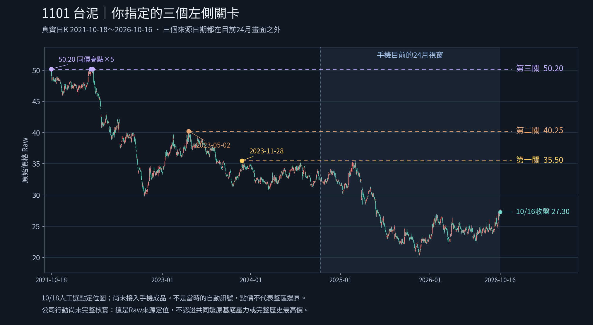

# 1101三個左側關卡：已選點，待接入主圖

使用者裁決：2026-10-18 15:19台北。本次接續分支dev/m1-v018-chart-annotations，收件前核實HEAD為718360c0495f3d29879ffa00de266e58ecb2023f。原引擎／策略／庫／歷史／舊成品／main保留。

> 20231128高點35.5左側第一關，20230502高點40.25第二關。第三關高點50.2

## 已核對的原始資料

| 關卡 | 使用者指定 | 原始日線核對 | 截至10/16 Raw收27.30 |
|---|---|---|---|
| 左側第一關 G1 | 2023-11-28，35.50 | 當日high35.50，完全相符 | BELOW |
| 左側第二關 G2 | 2023-05-02，40.25 | 當日high40.25，完全相符 | BELOW |
| 左側第三關 G3 | 50.20，未指定日期 | 五個high50.20來源日，全部列於JSON | BELOW |

G3同價來源：2021-10-18、2022-03-29、2022-03-31、2022-04-06、2022-04-07。使用者只指定第三關價位，**不把10/18或其他單日擅自認定為使用者唯一選日**。圖用最早同價日作繪線起點並畫出所有同價點，只是顯示錨；G3.source_date=null、matching_source_dates完整保存。這五日不是區域起訖的定義。

原下載JSON SHA2561718fd0fd66f3abb6bbacfb73e802235bbd647976aeb903ea8b0ea757daedde3；前輪已與固定交付HTML producer全部解析欄位相等，本輪重讀並做三高點／全部同價日／畫外條件核對，不是重新抓行情。新來源source_id及10/16 frame_id、chart_base精確綁在[人工案例](docs/visual-discussion/20261018_1101_selected_hurdles.json)，不同於原179根9/30案例。

這三關是使用者指定的**當前1101案例**，不取代原①26.10／④26.85，也不代表批准全市場自動排序。原①④的保存事件與回溯資格不刪。

## 真實定位圖

1213根真實日K全部繪出，未以週線或抽樣折線替代。底色只標目前24月瀏覽窗2024-10-16～2026-10-16（486根），不是整理區。三關的所有來源日期均在這個視窗之外；縮放不應刪掉已明選參照，但畫外提示須保留真實日期及價格基底。

圖為10/18人工選點定位／實作討論證據，**不是已改好的手機HTML或實機驗收**。圖PNG206189 bytes，SHA2561fa123b17f880728b9b3d008e2d37250452214fd66467c87462c3395cd0300ba。程式與案例皆在docs/visual-discussion，沒有產品引擎變更。繪圖需matplotlib與NotoSansCJKtc-Regular.otf；字型未放入儲存庫，可由notofonts/noto-cjk官方儲存庫取得。腳本參數--export原JSON、--output獨立輸出目錄、--font字型路徑。

## Codex可直接完成的工程範圍

1. 將這份精確source／frame／Raw／10/16人工案例接入**新的獨立**主圖版本。原已過①④和新未過G1/G2/G3分層，關卡編號不能互相混淆。三關順序照使用者，不按最近N個pivot或單一總分重排。
2. 在近期24月圖仍可讀G1 35.50→G2 40.25→G3 50.20的人工參照。來源在畫外能一鍵定位並回近期，定位不改分析日／股票／基底。價位超出當前Y軸時用清楚的畫外提示或關卡列，不以強拉50.20入近期價軸把K壓扁，也不把線畫錯到軸內。
3. G3只選價位／多同價日，證據保留全部日期；不自動合併五日為整理區，不選唯一使用者日期。G1/G2日期與高價精確核對。當前收盤BELOW是點價數字關係，未認證經完整公司行動校正的可交易共同基底壓力。
4. 保留原①④已過點價及已保存後續事件，不把「①④過了」說成「全左側區已過」。Raw／完整還原限制、reviewed_at晚於分析日的資格清楚；初版只精確匹配本次10/16 source/frame，其他日期／股票不套用人工案例，不倒灌成歷史自動訊號。
5. 證據預設以關卡、來源日期、價格、當前點價關係及人工覆核資格為主，長ID／原JSON可折疊展開。先做可見UI模擬／實際畫面，不能只改文案宣稱可用。
6. 接入JSON下載保留新人工案例與來源指紋，計算／顯示分離，UI不產生核心分類。驗證精確匹配、錯source／frame不套、畫外來源定位／返回近期、超Y軸提示、K量MACD窗／游標、原JSON精度與原策略／數值／庫不變。提供實際測試範圍、可下載小ZIP／SHA／入口；新HTML的Android另開狀態，不沿用這版實機部分證據。
7. 同一指定分支保存程式、交付、測試與CONTINUE；不覆寫舊不可變產物，不改main、不部署／付費／交易／發訊息／子代理。若環境限制，明示而保留未測。

## 本次沒有裁決的核心

區域時間／價格邊界、整區成交量、最高日量比較基準、增量門檻／持續時間、下跌急緩強度、時間衰減、正式整理型態、生命階段、一般自動選關仍未知。不把當天高價K的量當整區套牢量；不說三關等強、第三關正式魔王或突破即沒有任何套牢賣壓。只有五年與未完整校正Raw，不稱完整歷史最高或五年前無更高區。

Android沿用PARTIAL_EVIDENCE_OBSERVED，這輪沒有新增手機操作、JSON下載、瀏覽器測試或重跑357/21。唯一新執行為原檔核對、1213日K定位圖產生及目視檢查。已執行bootstrap --hydrate-missing成功，保留7個差異、未以舊checkout覆寫遠端。

下一步可交Codex做上述明確工程；未定區域規則繼續Work用具體圖確認，不讓未定自動規則擋住已明確的人工案例顯示，也不把人工案例接入算成全市場辨識完成。
