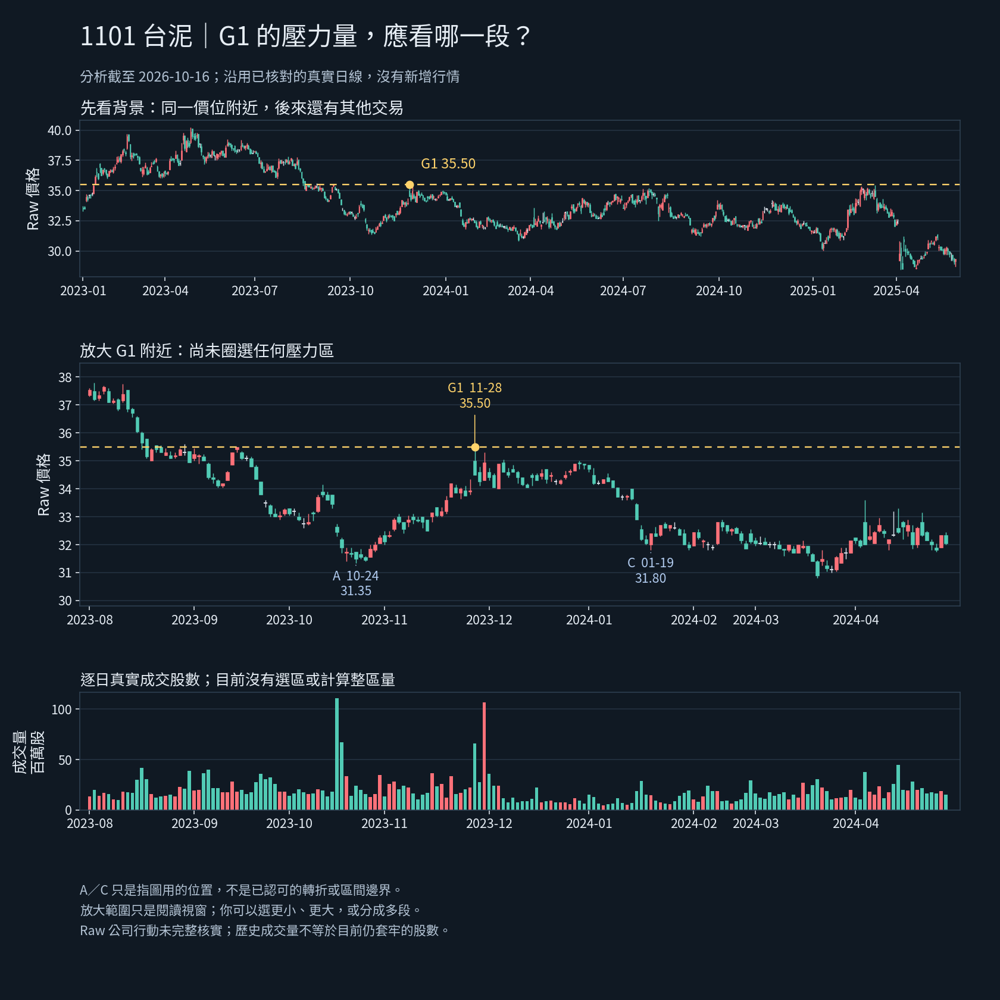

# 1101 G1區間判讀：真實K量圖（2026-10-18）

狀態：**WAITING_FOR_USER_REGION_JUDGMENT**。本輪僅製作討論圖，未批准區間、量比較規則、壓力強度或自動辨識算法。

## 唯一核心問題
判斷G1（2023-11-28／35.50）的左側壓力時，使用者會把哪一段K線及成交量當作同一個交易區？請直接指圖說從哪裡開始、到哪裡結束；可用A／G1／C或月份描述，但不受這些標記限制，可以更小、更大或分多段。先不要求量倍數、固定日數、精確公式，也不重問已確認的三個人工點。

## 來源與界線
- GitHub讀取基準a6559522856cf66885bd473aaed778f4706b5ca0，指定dev/m1-v018-chart-annotations確認identical。
- 原資料是已核對的0.1手機JSON之**保存副本**，從hurdle_chart/validation_android_20261018/android-original-evidence-1713.zip取回；不是重新要求使用者上傳，也不是0.2新手機下載。
- 原JSON1,185,454 bytes，SHA256369947bad71ab3fdff894c21511ebf242e1ddb12b59822d02ed93f0580bd2796；實際重算相符。解析1101新官方Raw／analysis_as_of2026-10-16、1213根日K。來源ID／frame_id／chart_base保留在g1_region_source.json。
- 背景576根（2023-01-03～2025-05-29），放大181根（2023-08-01～2024-04-30）。窗口只是為閱讀選取，不是正式壓力區界。
- A=2023-10-24 low31.35、G1=2023-11-28 high35.50、C=2024-01-19 low31.80；均直接核原始bar。A／C僅指圖用位置，不升級為使用者認可的轉折／防守／區界。G1是既有人工選點。
- 僅重畫真實OHLC與逐日成交股數，股數除1,000,000以「百萬股」顯示；沒有分價成本、剩餘持倉或套牢股數估計。沒有新指標或策略計算。紅K為close>open、綠K為close<open，平盤白色。
- Raw公司行動未完整核實，不認證共同還原基底壓力。分析日為2026-10-16，本輪2026-10-18回溯討論，不冒稱2023當時自動訊號。

## 本輪實際驗證
- 子集每根所有OHLCV字串與已保存原資料完全相等（非只比筆數）。G1及A／C值相等。
- 圖中放大價軸29.8～38.5，包住真實low最低30.80／high最高37.80，未裁切K線。
- Python繪圖實際執行；最終PNG1680×1680已view_image目視確認字體、價線、K／量時間軸及標記可讀，修正初稿註腳／刻度重疊後再實際渲染與目視。
- 圖像SHA256874c07379b57b1520dc651a2c51bcc5003d2e6a1a66ab1ead25a941e32fb9af2，240799 bytes。
- verification.json記本輪實際來源檢查。這不是應用程式、Chromium、Android、分類品質或交易績效測試；未重跑10／208／44或整套Python。
- 取回既有全段PNG時一次shell命令太長而失敗；改以分塊寫入成功。這是工具資料傳遞限制，不是股票產品FAIL。既有PNG已實讀，但本輪另用原JSON新畫本圖；不編輯舊圖。

## 保存／接續
同目錄有生成腳本、保留原精度的來源子集、最終PNG與verification.json；可用python3 build_g1_discussion.py --data g1_region_source.json --output g1_region_discussion.png --font <可用的繁中字體路徑>重現。
0.2本輪標籤差異已收束、Android整體PARTIAL_EVIDENCE_OBSERVED與未測互動不變；本圖不是新的手機證據。核心用途仍NOT_ESTABLISHED。使用者未回答前不計整區量、不定增量門檻、不自動選關、不標正式壓力強度或生命階段。
公司行動／五年Adjusted／歷史公布可得、資料缺口、SQLite未知根因及原file://管理拒絕保留。原引擎、策略、庫、歷史、舊頁與main不改，無部署／付費／交易／發訊息／子代理。下一步同Work直接收圖形判讀；明確後助手負責轉成可驗證規則。
