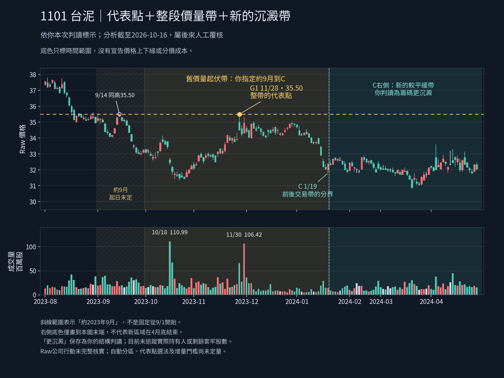

# G1代表整段價量帶；C右側形成新帶（2026-10-18 21:04 Work）

**本例語意已由使用者確認；一般自動算法尚未定義。** 本輪不再追問同一個G1選點或要求約9月的精確起日。

## 使用者裁決（事實／判讀分開）
完整原話保存於user_review.json。使用者說G1由高點與高量選為代表壓力點，實際代表一整個價格帶及成交量帶；壓力區約2023年9月到圖中C。這段有共同的起伏價格帶，G1高點水平線往左涵蓋其價格，左側有幾次較大量。C右側形成新的平緩價格帶，使用者判讀籌碼更沉澱。
原話「1023年9月」依同訊息及圖中日期解讀為2023年9月；未改寫原話。「成交量也是在G1左邊到2023年之間」保留原句，不加出另一個精確量窗口。

已確認的表示關係：
1. **代表點**：G1=2023-11-28／35.50，不將單根K與其量等同整帶。
2. **舊價量帶**：約2023-09→C（2024-01-19），共同起伏結構。起月是約數，exact_start_date=null；精確bar歸屬／價格上下緣／整區量尚未給定。
3. **新平緩帶**：C右側另分一帶，不和前帶任意累加。更沉澱為使用者的價量結構判讀，不是已驗證持有人未賣、沒有剩餘賣壓或買進資格。

助手推導的工程表示：以區域物件保存其代表點與獨立量峰；C作結構轉換參照，不能寫成固定N日切區。後帶存在不抹去舊帶的G1。這是對本例的表示方式，不等於已批准全市場自動算法、特定權重或量門檻。

## 真實來源核對（客觀數據）
使用前輪同源原JSON，SHA256369947bad71ab3fdff894c21511ebf242e1ddb12b59822d02ed93f0580bd2796；原1213根、1101新Raw、分析截至2026-10-16。不是新行情、新0.2手機匯出或從假想圖造價。
| 日期 | Raw high | 原始成交股數 | 說明 |
|---|---:|---:|---|
| 2023-09-14 | 35.50 | 18,247,932 | 另有同價高點；位於約9月不確定起點內，不擅定正式區間是否納入 |
| 2023-10-18 | 32.75 | 110,992,007 | 較低價處的較大量 |
| 2023-11-28 | 35.50 | 65,709,089 | 使用者指定G1 |
| 2023-11-30 | 35.30 | 106,415,572 | 在G1右側的另一較大量 |
| 2024-01-19 | 32.40（low31.80） | 14,495,609 | 圖中C |

2023年9月完整來源high均不高於35.50，9/14同價；因此資料層用「不高於／含同價」，不將使用者口語「之下」硬寫為嚴格小於。G1量大於9/14，但不如10/18或11/30，支持價格代表與量峰分開保存；**不推導成永遠先取最高價、同價再選最大量的正式公式**，也不替G1改日期。
g1_region_review_facts.json保留每根原始字串。未計整區總量、未聲稱精確分價成交或剩餘套牢量。

## 新圖與實際檢查

斜線標示約9月起點不確定；舊帶／新帶只畫時間底色，不把全高填色當已認定價格邊界，C右側顏色畫到本圖末端不代表4/30是新帶終點。G1仍真實點位；9/14同高與10/18／11/30量峰明示，非全部量強塞35.50。

實際以Python重畫181根真實OHLCV並view_image目視檢查，價量時間軸、繁中字與標記可讀。程式assert實際驗證原JSON指紋、五個來源日原值、同價關係、兩量峰大於G1且high低於35.50，以及9月high≤35.50。本輪沒有執行候選產品測試、Chromium、Android或交易驗證，未重跑10／208／44與整套Python。
PNG232080 bytes，SHA2565616dd77cd0e4e62ede65428e487007fd06a0b97f5eae0a2ad4e742d3f378f71。生成腳本同目錄；使用前輪../20261018_g1_region/g1_region_source.json，經--font傳入可用繁中字體重現。前輪待回答討論圖及源資料原樣保留。

## 已可做／仍未定
本例已可保存「代表點＋約略價量帶＋C後新帶」的獨立人工覆核契約，來源／分析日／reviewed_at分開；本輪已實際交付user_review.json及新圖。**尚未接入手機成品**，不能稱0.3已建好。原0.2標籤差異驗收收束不重開；Android PARTIAL_EVIDENCE_OBSERVED／未測互動及核心整體用途NOT_ESTABLISHED保留。

下一步工程可接人工區域顯示／證據，不需為畫約略區域逼使用者給精確起日，也不得把9/1→C當正式已選窗計量。一般自動分區、量價代表點選法、平緩／沉澱門檻、價格邊界、整區量及增量比較、強度／衰減／生命階段仍待實測定義；後續用G2等不同真實結構檢驗可否泛化，不重問本例已答部分。

Raw公司行動／五年Adjusted／歷史公布可得、完整歷史最高覆蓋、其他資料缺口與SQLite未知根因保留；原file://政策拒絕未重試／繞過。原人工三關JSON、引擎／策略／庫／歷史／舊頁／main未改。無部署、付費、交易、發訊息或子代理。本輪只新增人工判讀契約／來源事實／繪圖腳本及文件，不能冒充自動辨識或成交價分布分析。
