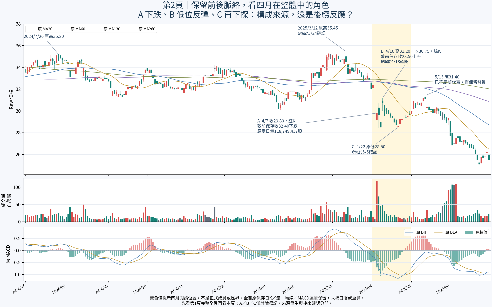

# 四月在整體中的角色：構成來源，還是後續反應？

接續84e0dd176d6f98d994cd6d3c45978688e5c19925。依已記錄「新圖須可放大」要求，交付兩頁研究PDF：第1頁保留原597筆全景，第2頁另呈2024-07-01～2025-06-30全部241筆原日K、量、均線與MACD，標四月A／B／C。先看完整背景，再看右端；不回到前輪已否定的68筆孤立小窗。這是研究圖冊，原互動主圖與數值引擎不變。

[開啟兩頁圖冊，可使用PDF檢視器放大](output/pdf/m1-april-role-study.pdf) ｜ [第2頁原尺寸PNG](april-role-context.png) ｜ [既有全景原尺寸](../20261020_broad_context_correction/broad-price-volume-context.png)



第二頁是向量K線、曲線及嵌入字形，可在PDF檢視器放大；第一頁沿用原高解析PNG。已實際檢查PDF兩頁渲染與文字、嵌入字形，沒有在Android實測手勢或App開啟流程，不冒稱產品驗收。若手機預覽無放大控制，可下載PDF交由手機PDF檢視器開啟；file://不重試不繞過。

## 本輪真正待判的核心差別

**在整個舊大帶脈絡中，四月急跌及其後的低位反彈／再下探，哪些屬於舊帶本身的構成來源，哪些只是後續反應？** 可分開判讀，不必把整個四月歸同一角色。

這不是重問已答2023/06～2025/04月份跨度，也不要求精確終點；不是再問局部與整體是否可分判、是否容許異質形態，或應否調降舊帶重要性。更不是重開5/13局部代表、6/3排除現箱、1/27等舊案例。關鍵是**來源出現在月份背景內，仍不自動等於正式整體構成**；它可能只是用來觀察原帶之後發生什麼。

助手尚未批准的工作假說：A先記為原區的後續轉弱觀測，B／C先單獨保留為低位局部觀測；沒有歸屬依據前，不直接納入舊帶構成。這不宣告舊大帶解除或重要性下降，不定正式生命階段，也不要求使用者接受整月同一答案。使用者可指出不同分法，無須提供公式、日期邊界或技術欄位。

本輪只有使用者「下一步」，尚未作答。pending-decision.json明列PENDING_USER_ADJUDICATION，全部正式欄位仍null；不把這個假說當規則交Codex實作。原共享來源角色舊問題仍PENDING_NOT_REASKED，新問題聚焦這次真實右端構成與反應，並非催答舊問題。

## 圖中原值與容易誤讀的反例

|標記／日期|原OHLC與量|已知事實及時點|
|---|---|---|
|A，2025/4/7|開29.20、高30.80、低29.20、收29.80；量118,749,437股|紅K，但較前一保存4/2收32.40下跌；不能因紅色說轉強|
|4/8|低28.45、收29.65|原6%低來源4/10確認；不把它當已定整體終點|
|4/9|收28.50|下一保存日的前收比較基準|
|B，4/10|開30.95、高31.20、低30.00、收30.75；量48,104,987股|綠K，但較4/9收28.50上升；原6%高點4/18確認|
|4/11|收30.00|完整反覆跌回保留|
|C，4/22|低28.50、收28.60；量14,504,369股|6%低點5/5才確認；當日低28.50高於4/8的28.45，不補成相等或破低|
|5/13|高31.40|已答局部代表，只作後續背景，不重問|

對原B77研究下緣30.05，4/7收29.80在下、4/10收30.75在上、4/11收30.00又在下；原值逐筆保留。30.05仍只是原研究參照，非本輪正式人工界線，也不能由一次破界決定歸屬或永久解除。圖不畫正式價界，不將黃色四月區當成成員範圍；日OHLC不證日內回測先後。

原6%高低與整箱時點沿前輪保持：B77來源末3/12高35.45、3/24整箱確認；B44／B80含四月來源但到5/13，整箱5/14／5/27才確認。新圖只是讓這個歸屬問題有足夠視覺脈絡，不依原箱跨月資格替使用者作答。

## 本輪實際完成

完成兩頁PDF、原尺寸PNG、精確241筆原資料與可重現build_study.py；比較檔SHA核同，原OHLCV／MA20、60、130、260／MACD逐字串讀取，不重算。新研究圖沒有輸入正式成員或核心答案。先用reportlab放入原全景，再合併Matplotlib向量頁，pypdf核兩頁及文字；pdftoppm渲染兩頁並用view_image實看。首稿CFF／Type42字型有Poppler相容警告，改嵌入Type3字形後無警告重繪，再看最終兩頁；最後CLI參數整理後渲染與已看圖逐byte相同。原圖、原數值及來源不變。

新圖已完成本機視覺核對，不等新瀏覽器／Android驗收。重新查本機仍無Chromium、Chrome、Firefox，不安裝、不走file://。無原核心／MACD／reaction執行、source query adapter CLI、bootstrap、14／22或其他舊產品測試、新ZIP。Android NOT_TESTED_NEW_BUILD；原測試／舊產品或手機驗收資格不提升。本輪GitHub逐檔回讀另見GITHUB_READBACK.json。

## 狀態與續接

未完成的是本例角色裁決、正式成員／區界代表／合併直接承接／解除生命階段；primary_pressure_id=null，historical_selection_time=null／historical_signal_eligible=false。PDF製作與資料核對完成，不冒稱核心辨識或歸屬完成。

保留11/25本例非關鍵點及一月小窗三選一撤回、所有已答概念／月份39筆5/13、6/3、1/27；未挑戰舊帶高點前不因低位整理先降重要性。五月十月原反例、原拒絕餘量−2.4800／−0.7825、來源發生／確認／實際選取、89版本84幾何非獨立、49轉換非訊號與不同窗不排名保持。A三箱及六月前40.25保留不自動納入整體，九點末反彈／119前33後77只是背景、不猜終點，同座標不合併投票、不跨尺度冒同尺度路徑。

正式增量／量權重／衰減重要性、Raw公司行動、五年Adjusted、歷史可得、九待核非窮盡日曆、Darvas、SQLite未知；核心NOT_ESTABLISHED／分類NOT_VALIDATED／行動NOT_EVALUATED。不調參硬編、不新增自動選關合併解除或買賣門檻，不改原核心參數策略庫歷史舊頁案例及main，不部署付費交易訊息子代理。下一步仍Work用圖討論這個新角色差別；已定規則或可重現缺陷才交Codex。完整續接WORK_HANDOFF.md。

重現圖冊：

```sh
python build_study.py --source <原comparison-data.json> --overview <原broad-price-volume-context.png> --font <繁中字型.otf> --out <研究輸出目錄>
```

依賴matplotlib、reportlab、pypdf；渲染用pdftoppm。原比較檔與全景SHA見evidence.json，PDF／PNG最終SHA與實際核對範圍見verification.json。重跑後視覺狀態回PENDING，必須實看新圖才能另記完成。
