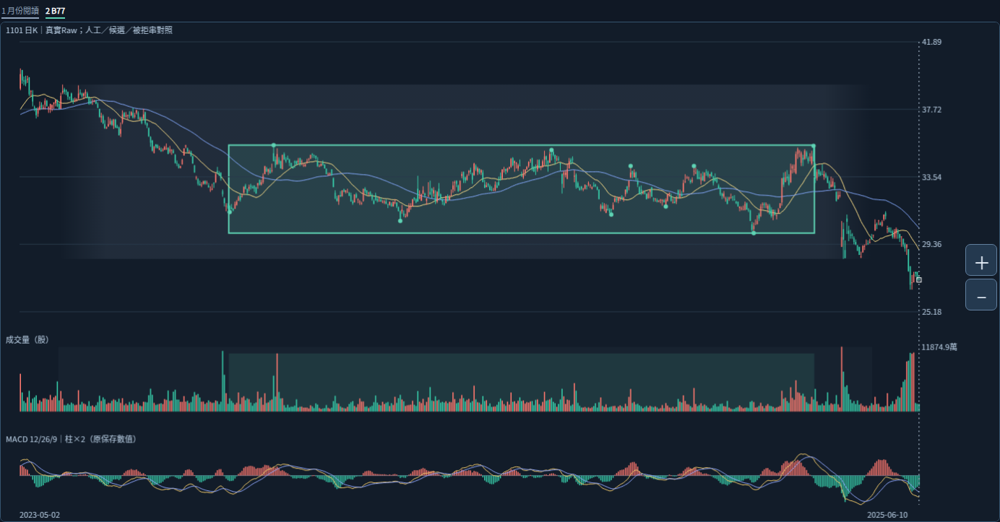
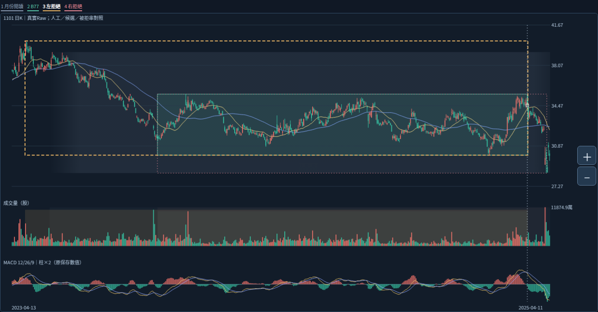
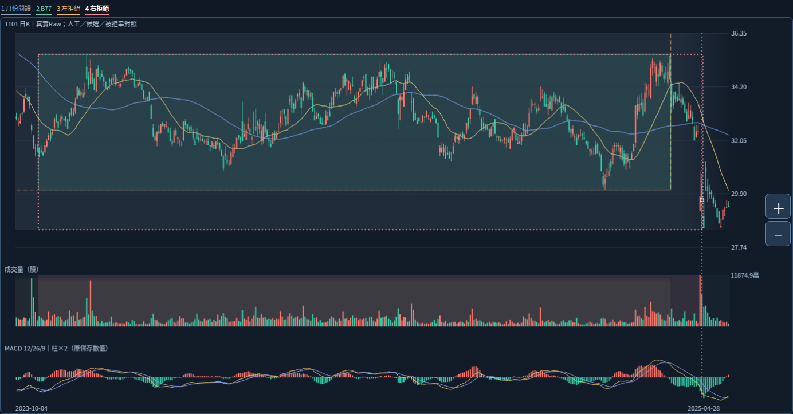
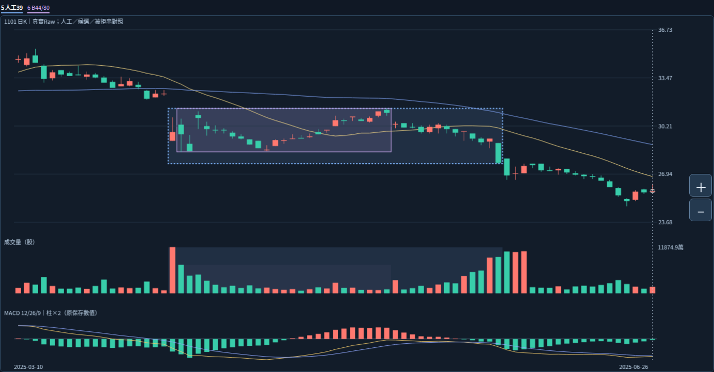
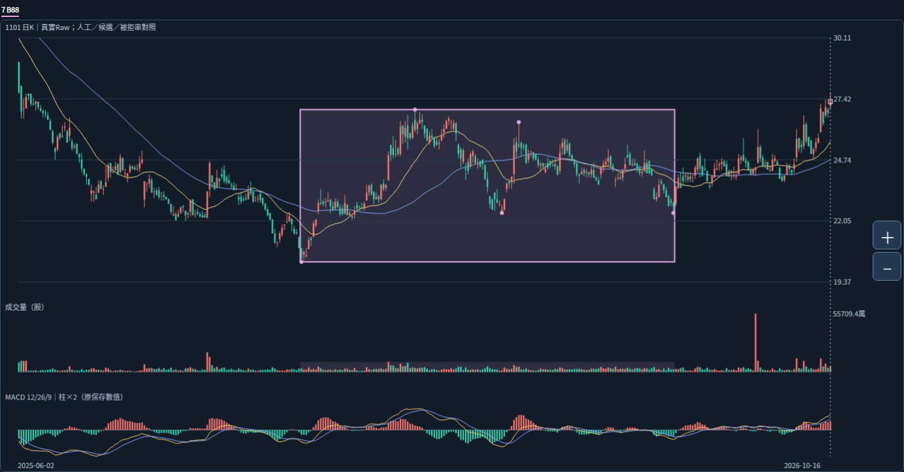

# 2026-10-20 Work｜真實跨尺度比較圖實看

狀態：ASSISTANT_ANALYSIS_NOT_USER_ADJUDICATED。固定分析1101／Raw／2026-10-16收27.30，非即時行情。本輪直接下載與操作新成品，沒有建立或調整核心規則。

## 來源與真正執行範圍

起點afb116d55b74bbed9718fea4015f0f00d3b2e11f；GitHub比較確認分支相同，包含fff47915523fab8c8de8279de8bbb7a26b05647b（成品）及cc71899668e1cd6f061af64739d279772a26287a（前交接）。讀AGENTS、CONTINUE最上、核心交接最新節、cross-scale交付WORK_HANDOFF全文／README／三份收據、模組README／source-acquisition／artifact-verification／驗收報告，沿讀兩份10/20 Work研究、舊時間軸／限制、graph_core_review四份文件、graph_diagnostics README／review-diagnostics／驗收報告、graph_core README、PROJECT_VISION／VISUAL_RULE_NOTES最新要求，以及主帶／6/3／39筆原已答案例。

本環境curl成功下載**749,695 bytes**小ZIP，SHA256 **894d93f852edce18f741695b96766210702c51be8b961916520fd3d29464d6c8**；CRC及6成員SHA均重新核。HTML **2,232,879 bytes**，SHA256 **f5b3b4e5e03da1c8291ff5854e0a6dfbb974286fe5cfbcb9a466ec6e138203ee**；嵌入payload與ZIP獨立comparison-data.json逐值全等。取得完整1213根K／量／原MACD／SMA與原核心，沒有新抓行情或執行辨識／指標引擎。這次取得成功不改寫先前Work的DNS失敗歷史。

既有Chromium133經loopback HTTP實開原HTML，操作七層比較／來源及時點定位／日期查詢／放大／真實滑鼠拖曳移圖／返回近期；1400及390寬觀察，保存**13張PNG**（含最初原字型畫面）。5組有限核對通過：左證人40.25、右證人4/8、各日期語義查詢、放大後真實滑鼠平移且筆數不變、前後完整資料／core／分析身分逐值不變；0 pageerror。這是本輪有限觀察，不是完整瀏覽器回歸、47項重跑、觸控／雙指／下載驗收或Android。詳[browser-observation.json](browser-observation.json)、[observe.cjs](observe.cjs)。

觀察機Canvas中文字型需替換：保留first-original-font.png，其後只在觀察頁DOM與Canvas字型改用既有ReviewCJK；成品位元組與數值不改。這項觀察用字型替換不代表原成品在使用者裝置的字型或效能通過。沒有使用file://、更改保護、安裝依賴、執行bootstrap或修改產品；只讀成品觀察不沿用他環境bootstrap成功。

## 實看結論

**自動核心抓到局部反覆結構，但尚未組成從現價回看的完整主要壓力脈絡。缺口涉及不同價位層次的關係與箱體歸屬，不能靠拉長色塊或放寬單一門檻補齊。**

### 月份主帶、B77與左右被拒串

灰色只代表2023-06～2025-04月份閱讀背景，綠色B77是2023-10-24～2025-03-12來源333筆。圖上可見較早高位逐步下移後，才進入B77反覆走廊；B77不是完整主帶。兩層可有關聯，不因此自動成為同一正式箱或已批准父子關係。463根與Raw28.45～39.25仍僅閱讀外包；精確端點、正式成員、價界與代表未知。

左拒串從2023-05-02／40.25開始，比人工六月背景還早。加入這個高點後，高群跨度6.05、容許3.5700、餘量**−2.4800**；原極值證人保持。真實圖顯示較高價位到較低反覆區的移動，這與「全部高點能否擠進同一穩定走廊」是不同問題。六月任意起點未被枚舉，不能說人工六月主帶已被直接拒絕。

右拒串延到2025-04-08；低群跨度3.25、容許2.4675、餘量**−0.7825**。4/7收29.80已低於B77研究下緣30.05，4/8低28.45再提供更低來源；這是原研究界的收盤與轉折事實。圖上急跌與後續較低反覆區，是研究「延伸或轉換關係」的實際位置，不是直接放寬條件把急跌接進原箱的理由。仍不判4/7為人工主帶正式終點；月份背景涵蓋四月也不等每根歸屬獲認可。

**助手研究建議（尚未批准）**：保持局部反覆走廊與被拒串原樣，另外研究不同價位層次之間的整體壓力關係；先區分前段高位下移、長期反覆與急跌後較低整理，不能把整段下移硬塞成一個橫箱，也不能丟掉被拒段的歷史壓力背景。這不是已建立的合併／重要性公式。

### 人工39筆與B44／B80同幾何

藍色人工時間4/7～6/2共39筆；紫色來源4/8～5/13共25筆。右側5/13以後仍可見回落、較低價反覆與6/2帶量下跌；來源色塊停止，沒有表示人工箱體必須停止。4/7與6/2是人工區間中重要量柱，但本輪不因單柱量或形狀推正式成員通則。

| 日期 | 意義 |
|---|---|
| 2025-05-13 | 最後來源轉折；既有人工局部代表31.40 |
| 2025-05-14／05-27 | B44／B80各自確認；同四來源幾何並非兩次獨立成功 |
| 2025-05-29 | 原研究界首次離開前的上一筆觀察記錄 |
| 2025-06-02 | 收27.70低於研究下緣28.45；同日另是已答人工整箱終點 |
| 2025-06-03 | 已答前箱破底脈絡，排除現箱；不重問、不改角色 |

日期相同不會使兩種語義相同：6/2研究界外不等於由演算法認出人工終點。25筆來源與39筆整體歸屬仍有缺口；B44/B80已抓到局部反覆，不稱完全漏檢；也不稱延長顯示就完成辨識。5/13選點不升為整體主壓力。詳[原頁日期軸](previous-date-axis.png)。

### B88近期箱與較長背景

本輪另外僅改閱讀窗至2025-06-02～2026-10-16，原數據與分析日不變。可見六月後先延續下跌，11/19低點後才進入B88來源；B88不能代表完整六月後結構。1/27高26.95的自動來源吻合，仍不等人工「1/27至最新可能沉澱」的全部歸屬或語義已重現。

B88來源到7/14、9/1才箱確認；1/27高點在6%／12%分別3/4／3/20確認。這些是事後已保存數值的對照，不能回寫為1/27當時已知。近期收盤序列原樣：10/12 27.00越過26.95、13 26.35跌回、14 27.05再越、15 26.80再跌回、16 27.30再越。MACD可見近期向上，仍無正式動能／增量／有效突破資格，不推持股沉澱。

## 未完成與下一步

本輪新判讀尚無使用者裁決。沒有新辨識規則、調參、人工日期輸入、正式主壓力選擇或自動歸屬修復。89版本／84幾何組非獨立型態；同尺度前綴鏈、跨尺度同幾何、不同局部串保持。B77的32廣義後來候選非直接承接；383／349／340／31不等長後續窗不排名重要性。

primary_pressure_id=null。正式區界／量口徑／增量／強度衰減／重要性／合併／直接承接／生命階段仍未知；Raw公司行動／五年Adjusted／歷史可得／9個待核日期與日曆非窮盡／Darvas正文／SQLite根因保持。核心NOT_ESTABLISHED、分類NOT_VALIDATED、行動NOT_EVALUATED、Android NOT_TESTED_NEW_BUILD；宿主、使用者開檔、裝置效能及觸控未測。

下一步**同Work**以本輪真實圖討論「不同價位層次如何保留成整體壓力脈絡」；不是重新問已答月份／39筆／5/13／6/3／1/27。現有圖已可供討論，沒有必須先交Codex的新工程阻礙。未定策略先研究，已定規則或可重現工程缺陷再交Codex。完整續接見[WORK_HANDOFF.md](WORK_HANDOFF.md)。原核心、參數、策略、庫、歷史、舊頁、案例、證據、私人圖庫與main保持；不部署、付費、交易、發訊息或子代理。
