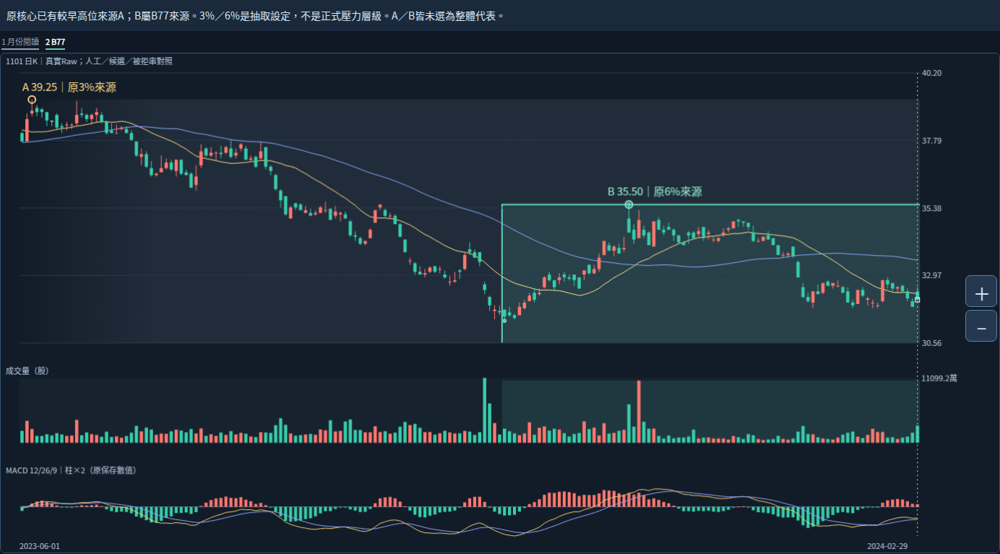

# 2026-10-20 Work｜已有高點來源與整體結構角色的缺口

研究資格：ASSISTANT_ANALYSIS_NOT_USER_ADJUDICATED。使用者10:34更正保持：未挑戰左側舊大帶高點前，不因右側低位整理／局部修復先調降其重要性；舊問題關閉，不重問。固定1101／Raw／2026-10-16收27.30，非即時。

## 本輪新發現

**原核心已有早段較高價轉折，但尚未將它們組成完整人工主帶及其高點角色。抽取轉折用的3%／6%／12%研究尺度，不能直接當作交易壓力的主次層級。**

A＝2023/6/5原高39.25，原3%研究尺度的已確認高轉折，6/28才確認。B＝2023/11/28原高35.50，B77的6%來源之一，2024/1/16才確認；同一可見高價亦有3%來源、確認日不同。兩者均是既有數值，不是本輪新增演算法或手工造點。

A的價位較高、抽取尺度較細；B的抽取尺度較大、價位較低。這個真實對照足以說明：不能只取較大尺度的B77，就認為已涵蓋完整大帶。它不證明A已是正式大帶代表，也不建立「價更高一定更重要」的通則。

灰色仍只有人工月份閱讀背景，綠色為B77來源；原日期與影線外包不升格正式成員或價界。B77仍是中後段來源，A在其左側，原左右拒絕串與餘量保持。

## 放大看早段高位到內部反彈

原資料中2023/8/2還有37.80的3%高轉折。5/2的40.25則在人工六月月份背景之前，且有三個尺度的來源；不能因此自動納入人工主帶或以較大尺度取代其月份範圍。完整來源ID／發生日／確認日／尺度見source-audit.json。同價來源只作並列，不合成獨立成功票或正式合併。

本輪有意保留「早段較高價來源」與「後段反覆區高點來源」兩者的證據。具體整體高點／代表如何由它們辨識仍未定；不將39.25、35.50或35.45補為使用者答案。也不反向將B77刪除，局部結構仍有其來源用途。

## 多參照附層目前覆蓋什麼

已完成reaction_facts的四個明示查詢是30.05、30.50、26.95、27.40。它們可以回答各自位置與反覆路徑，但不是全歷史主壓力清單。已答前箱局部代表31.40不在這份四參照selection中；31.40卻已存在原B44/B80研究上緣，並非原核心沒有抓到。這是有限例檔的覆蓋範圍，不是附層缺陷，也不應重做附層。

同樣，原3%高轉折39.25已存在，不等於整體主帶高點辨識完成。必須分開：原始來源是否存在、選入哪個明示查詢、在較大結構中扮演什麼角色。目前第一項已有許多來源，第二項有四個例檔，第三項仍有核心缺口。

## 後續研究方向與可檢驗要求

保留整體背景與尚未挑戰的高位；對現價由右回看，辨別近期修復、前箱局部代表、B77內部反覆與較早高位的關係。這不是指定通關順序或必須全部越過才能買進。

接下來提出整體辨識候選時，至少須用這個真實反例檢查：

1. 不能僅因較細研究尺度，就把已有的早段高位來源排除於整體結構研究。
2. 不能因B77是6%或較長穩定串，就把它當完整月份主帶；原拒串不能放寬門檻硬接。
3. 不能因原高點存在或把A畫上圖，就宣稱已選出整體高點、主壓力或正式區界。
4. 不能因有限selection沒有31.40，就稱原B44/B80漏掉它；要辨別來源、查詢覆蓋與語義辨識。
5. 既有局部上越／跌回可更新局部觀測，未挑戰舊帶高點前不因低位整理先降本例舊帶重要性。

以上是研究審閱要求，不是本輪已寫入產品的新辨識／重要性公式。此輪未提出新的正式大帶組合、合併／父子／直接承接或自動選關門檻。下一步仍Work研究整體結構與高點角色；不再擴大同一批小參照算術以代替此缺口，不重問已答日期或降權問題。

## 實際執行與限制

確認指定分支與c74695dcf5da6b7d37dab0feea81e5ec53d73110相同，讀三份根交接最新節與USER_CORRECTION全文。沿用本對話已核的原圖／原comparison-data及已完成reaction-facts，核既有來源SHA；只讀原core.pivots／原B77及B44/B80／catalog，沒有重算核心、附層或MACD，無bootstrap、新ZIP下載或22項測試重跑。

以Chromium133 loopback HTTP實開原未改HTML，兩個閱讀窗查原A／B來源ID及原K高價全等，另加觀察標記與ReviewCJK字型，2張新PNG；原data／core／分析身分全等、原HTML SHA不變、0pageerror。不是新產品UI、完整互動／觸控／下載或Android驗收。原字型首圖留前輪，file://未用未重試未繞過。詳browser-observation.json與observe.cjs。

發生日與確認日分開，所有圖是固定分析日的後來研究，不是歷史當時訊號。Raw公司行動可比性／五年Adjusted／歷史公布可得／九待核日期與非窮盡日曆／Darvas正文／SQLite未知保持；不將Raw較高價自動認證為可比經濟壓力。

primary_pressure_id=null；正式區界／整體代表／增量／衰減重要性／合併直接承接／生命階段未定。左高群6.05／容許3.5700／餘量−2.4800與右低群3.25／容許2.4675／餘量−0.7825不改；來源末轉折／確認／研究離箱／人工終點分開。49轉換或分段非訊號，89版本／84幾何非獨立型態，廣義後來非直接承接，不等長窗不排名。核心NOT_ESTABLISHED／分類NOT_VALIDATED／行動NOT_EVALUATED、Android NOT_TESTED_NEW_BUILD保持。

保留全部核心參數策略、庫、歷史、舊頁、案例來源證據與main；不重讀101圖、0.4.3或舊手機驗收，不部署付費交易訊息子代理。研究同分支保存並逐檔GitHub回讀。完整續接見WORK_HANDOFF.md，已定規則或可重現工程缺陷才交Codex。
