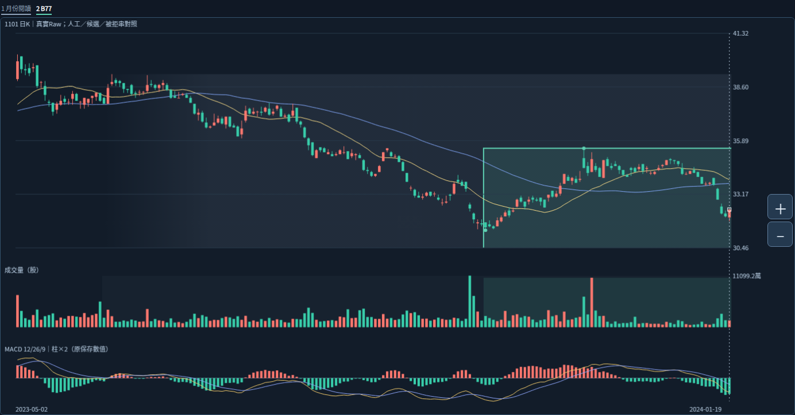

# 正面結構證據與中間路徑：開始區分「同價」背後的不同關係

本輪Work接續7b0450bcab4074e1eee05cc78db66b265647908d，分支相同，保留全部來源反查、原圖及研究。正式歸屬仍未批准；共享交界角色問題仍PENDING，本次「下一步」不當答案，本輪亦不重問。以下結論均為ASSISTANT_RESEARCH，不是自動分段、合併、解除或權重規則。

圖是前輪已保存真實K／量／MACD閱讀窗，不是本輪新截圖。框是來源範圍，不是正式整體價界或起訖；B77原末來源亦不當整箱終點。較早B6的原值與前後路徑另列下表，不假稱圖上畫了B6。

## 一、能支持目前整體描述的正面證據

現有資料可支持一個**研究描述假說**：早段高位來源、下移銜接路徑、後段反覆區，各自有可追溯的原值角色。它符合已確認「整體可含不同形態」的容許範圍，但尚未證明三部分的正式歸屬。

- 早段A原高39.25及完整9點3%路徑存在，不因局部箱跨六月前就遺漏它；也不連帶把原箱內40.25等全部來源納入人工整體。
- 9點路徑末段有反彈，10/24低31.35與B77首來源同座標，但3%／6%原ID與確認保持分開；這是接點觀察，不是已批正式共享角色、父子或承接。
- B77本身有原10個高低來源，後段反覆不是只靠讀圖外框猜出。五個原高點如下：

|原6%高來源發生|價位|原確認|
|---|---|---|
|2023-11-28|35.50|2024-01-16|
|2024-07-26|35.20|2024-08-15|
|2024-09-30|34.20|2024-10-24|
|2024-11-25|34.20|2024-12-20|
|2025-03-12|35.45|2025-03-24|

最後35.45較前一高34.20回升1.25，但仍低於首高35.50達0.05，不補為相等或突破。這能支持保留「中後段反覆區」的候選角色；五個來源不當獨立型態票，也不能因此讓B77替代整個人工大帶或指定正式代表。

## 二、新區辨證據：相同價區，中間可能走過完全不同路徑

此前已知B6（2022-11-14～12-16）研究範圍32.50～34.70，與B77的30.05～35.50重疊。這輪進一步讀B6原保存path，並用原OHLC收盤序列獨立核對全部轉換；兩者完全一致：

|原保存日期|收盤|相對B6原研究範圍|
|---|---|---|
|2022-12-21|34.05|形成時在內|
|2023-01-12|35.40|收上34.70|
|2023-09-06|34.40|從上方收回範圍內|
|2023-09-13|35.30|再次收上34.70|
|2023-09-20|34.35|再次從上方收回範圍內|
|2023-10-18|32.45|收在32.50下方|

從B6原確認日含當日，到B77首來源日前一筆，共198個保存記錄；其間最高日高40.25、最高收盤39.90均在2023-05-02。這是本圖左端高位之後回落的前置路徑，不因40.25出現在這個比較中就把它指定為人工整體成員或代表。

**分析：B6與B77同價，不等價格一直在同一區反覆。中間曾向上離開、在更高處交易、再向下返回。** 相對地，在2023-06-28～10-23同一80筆窗口內，價格既有收上B6研究高界、又有收下B6研究低界的記錄，但所有保存日高都低於A原39.25。這提供了不同來源被如何走過的實際差異，不是重要性排名；A也不因此自動成為正式整體高點。

A發生後至固定分析日的817筆保存記錄，日高均嚴格低於該39.25原值。這只陳述已保存Raw資料；九待核日期／日曆非窮盡與公司行動仍未知，不能改說全市場歷史已完整認證未挑戰。

原path中的FAILED_UP_RETURN_IN_RANGE名稱，只按原研究界描述上方收回，不將1/12至9/6的長路徑包裝成已驗證短線假突破。原事件名稱保持，不改核心結果，也不據此宣告B6正式解除或後來恢復壓力。

## 三、同時找到反例：離區再回來仍不是自動切新帶的充分條件

檢查比較檔已保存的7條同尺度來源前綴版本邊，保留全部檢查記錄；其中B74→B76有以下原保存事件：

|項目|原值|
|---|---|
|B74原確認|2024-12-20|
|B74原研究下緣|30.80|
|2025-01-10收盤|30.25，低於舊下緣|
|2025-01-15收盤|30.80，等於舊下緣|
|B76新增原研究下緣|30.05|
|B76原確認|2025-02-12|

B74來源ID是B76來源串的完整前綴，這是原保存的版本關係。若只憑離區再回返就宣告全新獨立結構，會跳過這個來源版本事實；但版本關係本身也不批准正式經濟同帶。

1/15只是收在舊下緣相等處，原path歸INSIDE包含等界，不補成站到下緣上方。後來B76的30.05不能倒灌成1/10當時沒有跌破B74的30.80；當時事件與後來版本各自保留。這個反例沒有建立新的「幾天／幾次／幅度多少才分段」門檻。

## 對正式歸屬的研究進展

本輪找到的候選證據維度是**中間價格如何離開與返回，以及來源是否只是同一有序串的版本延長**。二者需要並列閱讀，不能用其中一項直接替代正式歸屬。它在上述真實對照中有可觀察差異，尚未在獨立樣本驗證為充分判準。

目前支持「早高位＋下移銜接＋內部反覆區」作研究描述；未解決的仍是：哪些來源正式納入哪個整體、如何處理不同形成過程、正式區界與代表。沒有自動合併、選主壓力、因跨界就解除、量權重、衰減或買賣規則，primary_pressure_id=null。舊帶未挑戰高點前不因低位整理先降本例重要性保持，也不因其他參照被走過就排名或宣告失效。

## 本輪實際執行

確認分支與7b0450b相同，依序讀三根最新交接。沿用已全文讀的來源反查成品與契約／限制；核原comparison SHA184bdef0b687ec0ab7bfcaaac2157ff7916fbc1000ef312d81b5efc0c2e73e15與query SHA4a43a8c0f03bbffacb86306f064b7c807a7a83bdaf7e737bc76cd654a2c1dbb0、原result身分相同。只讀B77十來源、B6原path／原OHLC與已保存7條前綴邊；獨立收盤掃描與B6六個原轉換全等，原來源高低與K欄位核等；完整證據evidence.json。

舊真實PNG由GitHub取回逐byte核等，沒有新瀏覽器嘗試／截圖，前輪缺Chromium未冒稱解除。沒有source_query／adapter／CLI、原辨識／MACD／reaction、bootstrap、14或舊測試、新ZIP或Android重跑。Android NOT_TESTED_NEW_BUILD；file://不重試不繞過。這是只讀研究核對，不是新核心驗證或策略回測。

完成：正面結構來源整理、同價不同中間路徑對照、同來源版本的離區回返反例、時點與原數值核對及同分支回讀。未完成：正式整體成員／區界代表／合併直接承接／解除生命階段、自動辨識與共享交界角色裁決。歷史選取null／historical_signal_eligible=false；新query實際selected_at保持2026-10-20T07:30:12.393327+00:00，不當歷史訊號。

下一步仍Work檢查候選路徑證據與來源身分如何共同支持或反駁具體歸屬假說，不能因本輪新維度就交Codex自動切段。三個已定概念與月份、39筆、5/13、6/3、1/27不重問。五月反覆站回跌回／紅K較前收跌、十月日高過而收未過／相等低／正MACD跌回均保持；日OHLC不證日內順序。原拒絕餘量−2.4800／−0.7825、49轉換非訊號、89版本84幾何非獨立型態、不同窗不排名保持。

正式增量／量權重／衰減重要性等未知，Raw公司行動／五年Adjusted／歷史可得／九待核非窮盡日曆／Darvas／SQLite未知；核心NOT_ESTABLISHED／分類NOT_VALIDATED／行動NOT_EVALUATED。不改原核心參數策略庫歷史舊頁案例證據或main，不調參硬編答案，不重讀101圖／0.4.3／舊手機驗收，不部署付費交易訊息子代理。已定規則或可重現產品缺陷才交Codex；逐檔回讀收據GITHUB_READBACK.json，完整續接WORK_HANDOFF.md。
