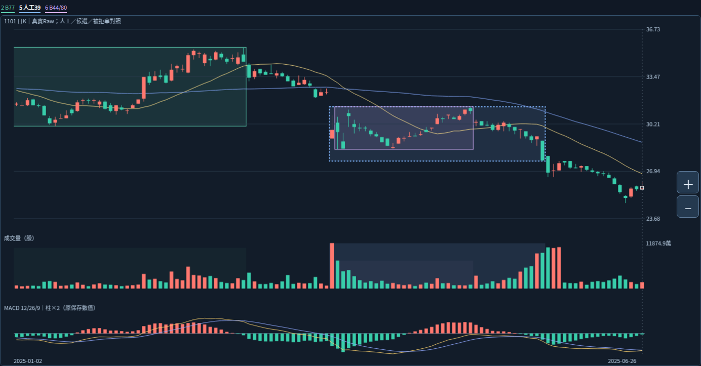

# 正式成員與後續反應：兩種關係不能互相替代

本輪Work接續711ef529ed43675b987dadda6a53950a58e041bc，分支最新相同。使用者只要求繼續研究；前輪「交界來源可否有多個正式角色」仍未裁決，本輪不假設批准，也不重問。以下研究不依賴該問題的答案。

圖上的框是原來源／閱讀範圍，不是已批准整體起訖。綠框停在原末來源日，不表示整箱或舊帶當天結束；紫框來源亦不等人工39筆整箱。固定1101 Raw、分析2026-10-16，非即時行情；本輪無新截圖或瀏覽器測試。

## 新核對一：同一局部幾何的發生與確認，跨過月份背景

已答人工大帶閱讀月份為2023-06～2025-04；不補精確終點。原B44／B80使用同四個實際高低點，但尺度／ID／確認不同：

|實際來源|原價|3%原確認|6%原確認|
|---|---|---|---|
|2025-04-08低|28.45|04-10|04-10|
|2025-04-10高|31.20|04-11|04-18|
|2025-04-22低|28.50|04-29|05-05|
|2025-05-13高|31.40|05-14|05-27|
|整個原候選箱確認|—|05-14（B44）|05-27（B80）|

四點中三點發生在四月；五月的新高來源尚未出現時，不能把後來完整四點箱倒灌成四月已形成。4/22同價低點也不能因3%較早確認，就把6%的5/5確認資格提前。這仍是原保存確認下限；真實歷史公開可得與實際當年選取未核。

研究以月份閱讀末日4/30對照時點，**不把4/30認定正式整體終點**，也不因5/13在該閱讀月外就自動裁箱或排除正式成員。能排除的是推論跳躍：後來局部箱用了四月來源，不足以證明它在四月已形成，或整個箱已屬於同一舊整體。

新來源反查例檔只查三個2023年來源；上述五月案例另按原same圖層的B44／B80 ID讀原保存core，沒有重做／重跑query，也不是例檔漏檢。B44／B80同幾何不作兩個獨立型態或支持票。

## 新核對二：這次局部窗沒有碰到B77的原研究高群

對已答人工39筆的原OHLC逐筆只讀核對：日高最大31.40，全部低於B77原研究高群下緣34.20，相差2.80；該研究高群原為34.20～35.50。這個局部窗與B77研究範圍的影線外包交集只有30.05～31.40。

所以這段資料可供觀察價格相對舊來源區低部的位置與反覆；它**沒有檢驗到B77研究高群，更不能據此稱已挑戰人工整體高點**。34.20～35.50仍只是原研究高群，不補為人工整體正式上界或使用者代表。Raw跨年公司行動可比性仍未核，幾何不當經濟賣壓認證。

39筆相對30.05的收盤位置為13上、0等、26下，只是同一固定窗的完整位置統計，不是13／26多空票、26次獨立跌破、重要性排名或新門檻。原reaction_facts的事件路徑保持，不用這組彙總取代五月反覆站回／跌回或十月反例。

## 對正式歸屬的實際推進

|研究關係|本輪已有依據|仍缺的正式結論|
|---|---|---|
|原形成來源|哪些原高低點被哪個原箱採用、各自發生與確認|它們是否為較大整體的正式成員|
|後來相對舊區的位置與反應|完整原價路徑、到達哪個價位部分、哪些部分未到|是否確由舊壓力造成、能否調整哪一層的判斷|
|整體歸屬|已答月份背景與不同形態容許概念|正式成員／區界／代表／合併判準|

**分析：後來的局部結構可以提供相對舊區的觀測，但不能僅因價位重疊或引用了較早來源，就把正式歸屬升級。** 本輪把相關資料暫保留為後續觀測的研究證據，不做正式成員標記，也不宣稱壓力因果已成立。這是證據不足時不越級的判讀，不是新生產歸屬算法。

舊帶尚未被挑戰的高位與重要性保持；本輪也不因局部失敗就額外增加整體權重。局部上攻能力、舊來源區的互動與整體本身分開看，不隔離其可能關係。沒有新增時間、距離、量、衰減或買賣門檻。

## 實際執行與保留

確認分支與711ef52相同，讀三根交接最新節與前輪pending-decision。沿用本對話已全文讀的新交付／契約／驗收／request及來源反查JSON；本輪再核本地30584-byte JSON SHA4a43a8c0f03bbffacb86306f064b7c807a7a83bdaf7e737bc76cd654a2c1dbb0與原core身分相同，原comparison SHA184bdef0b687ec0ab7bfcaaac2157ff7916fbc1000ef312d81b5efc0c2e73e15不變。只讀四來源及各自原確認、39筆窗口、原研究區與精確比較，詳evidence.json。

原PNG從GitHub取回並與本地沿用圖核等；第一次比較的空白正規表示式誤植，修正base64空白正規化後原內容全等，未放寬內容比較或修改圖片。詳read-provenance.json。沒有新瀏覽器嘗試或截圖、無重試file://；前輪缺少本機Chromium的限制未冒稱已解除。

本輪未執行source_query／adapter／CLI、原辨識／MACD／reaction重算、bootstrap、14或舊測試、新ZIP或Android；既有14測試及27檔回下載是工程歷史，不當本輪重跑。Android NOT_TESTED_NEW_BUILD。

完成：跨月份的原來源／確認時點核對、局部窗到達範圍與缺證核對、正式成員與後續觀測的主張範圍整理及同分支回讀。未完成：前輪共享交界正式角色裁決、正式整體成員／區界代表／合併直接承接／解除生命階段與主壓力辨識。primary_pressure_id=null；歷史選取時間null／historical_signal_eligible=false。

下一步仍Work比較整體歸屬假說的正面依據、反例與缺證，不因這輪研究新增工具或轉Codex重做附層。前輪角色問題保持PENDING，這輪不再次要求回答；已定規則或可重現產品缺陷才交Codex。

三個已定概念與月份、39筆、5/13、6/3、1/27不重問。五月5/14紅K但較前收跌、19跌回20／21再站22又跌回，十月日高過而收未過／相等低／正MACD跌回及完整路徑保持。原拒絕餘量−2.4800／−0.7825、來源末點／確認／研究離箱／人工終點分開，相等不補過破、日OHLC不證日內順序、49轉換非訊號、89版本84幾何非獨立型態、不同窗不排名不變。

正式成員、區界代表、增量、量權重、衰減重要性、合併直接承接、解除及生命階段未知；Raw公司行動、五年Adjusted、歷史可得、九待核非窮盡日曆、Darvas及SQLite未知；核心NOT_ESTABLISHED／分類NOT_VALIDATED／行動NOT_EVALUATED。保留原核心參數策略庫歷史舊頁案例證據與main，不調參硬編答案，不重讀101圖／0.4.3／舊手機驗收，不部署付費交易訊息子代理。成果同分支逐檔回讀，收據GITHUB_READBACK.json，完整續接WORK_HANDOFF.md。
