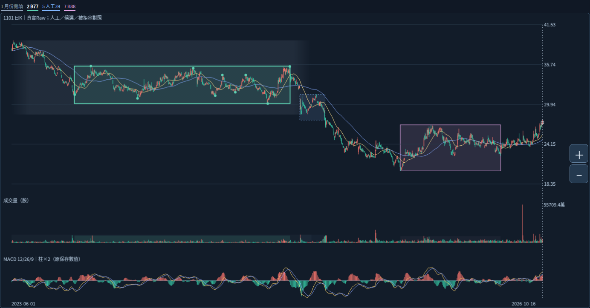

# 2026-10-20｜跨層次壓力：重返一部分，不等整帶解除

狀態：ASSISTANT_ANALYSIS_NOT_USER_ADJUDICATED。這是既有真實圖的研究判讀，不是新辨識核心、正式合併／重要性規則或交易建議。1101／Raw／固定2026-10-16收27.30，非即時。

## 本輪結論

建議分開記錄「局部幾何是否成箱」與「從現價回看的整體歷史壓力背景」。前者未通過，不直接推成後者無關；局部重新進入／越過，也不直接推成整個背景壓力已解除。完整背景內仍需保留不同價位、局部反覆、離開後的回返與反證，不能用一個加長矩形代替。

這個建議不擅自把整段合併成正式單箱，不批准三個新箱、父子關係、直接承接、支撐轉壓力或固定突破門檻。既有人工主帶的重要性是已答案例；本輪新增的是如何保存內部差異與部分修復的研究命題，尚未獲使用者裁決。

## 真實全景：背景與局部同時保留

灰色：人工2023-06～2025-04月份閱讀背景；綠色：B77來源；藍色：人工39筆；紫色：B88來源。月份首末讀圖日不是正式端點，所有外框僅顯示影線外包。本圖只用原成品的勾選／閱讀窗重新截圖；沒有新畫歷史價格、補資料或新增主關卡。

圖上早段高位下移、中段反覆、急跌後較低整理與更後段反彈均保留。時間順序不等直接承接；不能從畫面推剩餘套牢持股、壓力強度或未來必然受阻。

## 新的具體對照：局部回返與整體收復分開

| 已核原值／幾何事實 | 可以支持的研究問題 | 尚不能推定 |
|---|---|---|
| B77來源最後轉折3/12；其後3/13～4/2仍有15筆，收盤32.05～33.85，均在原研究界30.05～35.50內 | 來源色塊停止後，仍需保存價格對原區的互動 | 15筆已正式屬於B77，或3/12就是整箱終點 |
| 4/7收29.80低於B77研究下緣30.05；4/8低28.45 | 保存離開舊區的實際位置與之後的演變 | 4/7為人工月份主帶正式終點／唯一轉換日 |
| 5/13高31.40，位於B77研究界30.05～35.50內；仍低於3/12高35.45 | 這是實際「回到原區下半部但未回前高」的例子 | 站回一部分已消化全部大帶、或必須突破35.45才能買進 |
| B77顯示外包30.05～35.50，人工39筆外包27.65～31.40，垂直交集30.05～31.40 | 不同時間段可有重疊價位，值得保留關聯證據 | 交集就是正式壓力區、重疊必然增強、兩段必須合併或有正式父子 |
| 5/13後回落，6/2收27.70；6/3原已答前箱破底脈絡保持 | 保留回返後再失敗的路徑，不只保存曾到31.40 | 以後每次回返都會失敗／該帶具有已校準勝率 |

上述都是後來讀取固定資料的對照，不是把5/13未來走勢提前提供給當時模型。Raw跨公司行動可比性未核，不將上述原價交集認證成共同校正後的經濟壓力。

## 早段高位下移：保留背景，不能強塞水平箱

早段不是所有高點都維持同高；它仍是使用者已指出的長期背景的一部分。左拒從更早2023/5/2開始，不等人工六月背景本身被拒。左高群6.05／容許3.5700／餘量−2.4800，右低群3.25／容許2.4675／餘量−0.7825全部保留。不調35%或3／6／12%門檻，不把人工月份輸入自動核心。

## 建議研究的三種路徑（不定條件或機率）

1. 重返下部後受阻：只新增該次回返／失敗證據，不能聲稱全帶強度已量化。
2. 在重返區反覆並逐步向上：保存正在接觸的部分與上方尚未處理的歷史，不把第一次站回就當整體完成。
3. 回返後再跌離：保留前次修復與新的反證，不能只顯示最後一次成功或讓原判斷因時間經過自動變強。

三種路徑是日後可對照的競爭情境，未設定真實機率、連續天數／量倍數、正式生命階段或買賣資格。也不能反向主張歷史壓力永不失效；衰減、何時解除與如何反證仍待研究。

本輪真正的新核心問題只有：**是否認同把「重返／突破局部」與「整體壓力背景已解除」分開更新？** 我的建議是分開；目前不將建議寫成批准策略，不重問月份、39筆、5/13選點、6/3、1/27或舊案例。

## 本輪實際工作與限制

分支基準e0dc1328a0050673239b4bbcec655d2dbadfb445，compare確認與分支相同；包含固定成品fff47915523fab8c8de8279de8bbb7a26b05647b。讀根AGENTS、CONTINUE頂端、graph-core續接最新節；前輪真實圖README／WORK_HANDOFF全文、browser-observation／verification／GitHub收據；固定圖交付WORK_HANDOFF全文、README／封包／來源／回讀收據、模組README／source-acquisition／驗收報告；讀原核心review四文件及相關Work、人工原話與核心／診斷契約。舊收據不是本輪重測，未重讀101圖或0.4.3。

本地沿用前輪已取得HTML與完整JSON，重新核二者SHA均與固定成品收據相同。不是新下載小ZIP／CRC重測。以Chromium133、loopback HTTP實開同一HTML，只改閱讀窗／圖層，保存1400寬三張新PNG。觀察頁DOM／Canvas沿用ReviewCJK字型替換，原字型首圖保留在前輪。前後完整data序列化全等、HTML SHA不變，0pageerror；見browser-observation.json。這不是拖曳／雙指／下載回歸、47項／7 Python重跑或Android實測。沒有bootstrap、辨識或指標引擎重跑，沒有產品源碼變更。

B44/B80同來源25筆、各自確認與人工39筆保持；來源末轉折／確認／研究離箱／人工終點語義不混同。B88不自動代表六月後整段，1/27／26.95來源吻合不等人工沉澱成立。89版本／84幾何組非獨立型態，廣義後來非直接承接，不等長觀察窗不排名。

正式區界、量口徑／增量、衰減／重要性、合併、直接承接與生命階段仍未知；primary_pressure_id=null。Raw公司行動／五年Adjusted／歷史可得／9待核日期與日曆非窮盡／資料缺口／Darvas正文／SQLite未知保持。核心NOT_ESTABLISHED、分類NOT_VALIDATED、行動NOT_EVALUATED、Android NOT_TESTED_NEW_BUILD。file://未用、未重試或繞過。

下一步留在Work，用上述真實回返例子裁決這一新增關係；目前沒有已定的新核心公式或可重現工程缺陷要交Codex。完整續接見WORK_HANDOFF.md。保留全部核心、參數、策略、庫、歷史、舊頁、案例證據與main，不部署、付費、交易、發訊息或子代理。
