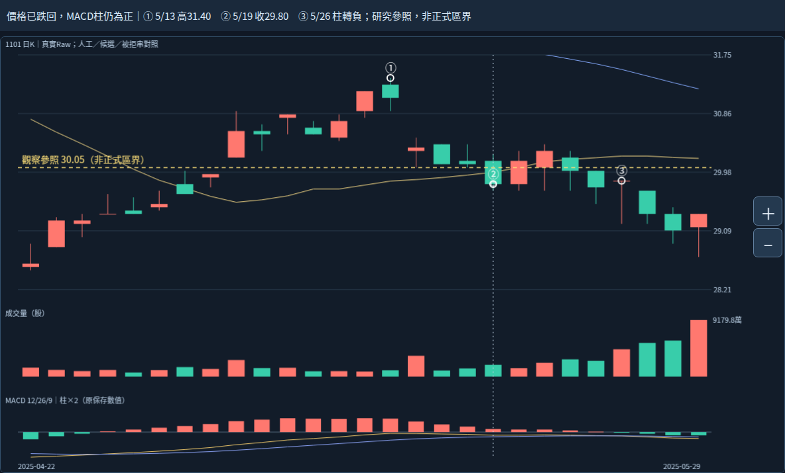
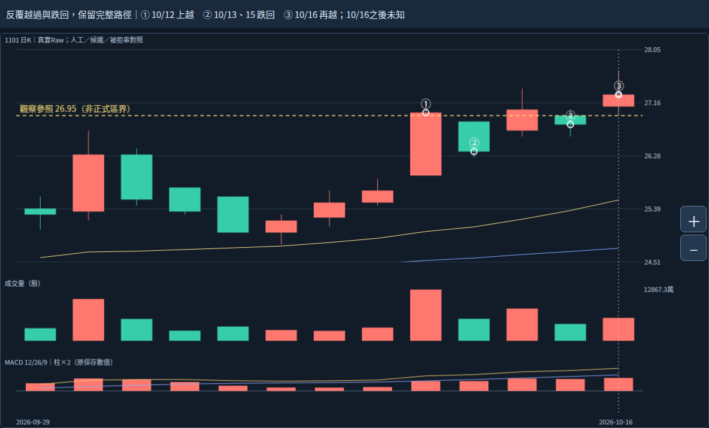

# 2026-10-20｜使用者已確認分別判斷；繼續看價格與指標衝突

## 已確認的核心原則

使用者於本輪回覆「認同，繼續」，直接承接上一輪問題：「你是否認同：『重返／突破局部』與『整體壓力已解除』應分別判斷？」

這一命題狀態更新為 **USER_CONFIRMED_PRINCIPLE**，不再追問。局部變化仍可成為整體評估的證據，分別判斷不表示各層互相隔離。這不等於使用者已核定正式區界、整帶解除條件、合併、父子、直接承接、重要性、量口徑、動能權重或買賣資格。精確同意範圍見user-decision.json。前輪README與收據中的「尚未獲答」保留為歷史，最新狀態由本紀錄及三份根交接覆蓋。

## 新真實反例：價格先跌回，MACD柱仍正

黃虛線30.05沿用B77原研究下緣，僅本輪觀察疊線，非人工大帶正式下緣或新出場線。畫面仍是原固定HTML／K量MACD；①②③是本輪讀圖標記，不是自動訊號。

| 日期 | 保存價格事實 | 原MACD柱（顯示兩位） | 應分開保留的證據 |
|---|---|---:|---|
| 2025/5/13 | 高31.40、收31.10，在30.05上方 | +0.63 | 局部回返事實，非整帶解除 |
| 2025/5/14 | 收30.35，比前日31.10低，仍在30.05上方 | +0.49 | 當日回落與指標仍正同時存在；不能提前說已跌回30.05下方 |
| 2025/5/19 | 收29.80，低於30.05 | +0.15 | 已跌回參照下方；正柱不能抹去這個事實 |
| 2025/5/26 | 收29.85，仍低於30.05 | 略低於0（原值負數） | 柱首次由正轉負發生較後；不可因兩位顯示為零就失去負號或精確比較 |

5/26柱原值−0.00307575569432120026846986357371843860771300970856；完整原值保存於facts.json。圖的顯示四捨五入不作判斷輸入。這不是建議等MACD轉負賣出，亦不是創設5/19賣出規則；只用反例證明「MACD柱為正」不能等同「價格仍守在參照上方」。5/13高點的來源轉折後來才確認，當日只能讀當日原始高價，不倒灌已確認轉折標籤。

## 近期對照：再次上越，仍保留先前跌回

黃虛線26.95沿用原1/27參照／B88研究上緣，不作正式整箱區界或自動進場線。原案例及確認日期保持。

| 日期 | 收盤相對26.95 | 原MACD柱（約） |
|---|---|---:|
| 2026/10/12 | 27.00，上方 | +0.27 |
| 2026/10/13 | 26.35，下方 | +0.27 |
| 2026/10/14 | 27.05，上方 | +0.34 |
| 2026/10/15 | 26.80，下方 | +0.33 |
| 2026/10/16 | 27.30，上方 | +0.36 |

五次客觀位置與四次位置轉換均保留，不能只顯示最後成功上越。10/13收盤跌回時，原MACD柱甚至比10/12略高（完整精度），同樣說明指標與價格不是同一事實。10/16後資料未提供，不能稱已完成回測、後續成功或整帶消化。兩個閱讀窗只對照事實與指標不同步，不作型態成功率、重要性或報酬排名。

## 向可執行規則前進：已定原則與待定判準分開

已定且能交給工程遵守的約束：局部事件不能直接改寫成整體壓力解除；數值位置、支持／反面證據、整體判斷與行動資格各自保存。相反方向的證據可以同時存在，舊跌回不可被後來上越刪掉。這些沿用已定因果／證據分離原則，不要求再作同一題確認。

本輪進一步研究建議（ASSISTANT_ANALYSIS_NOT_USER_ADJUDICATED）：

- 對一個已明示的研究參照，先按當時完成收盤記錄在上、在下或相等；若等於就保存相等，不自行補成突破或跌破。這是原值關係，不是「有效突破」判準。
- 再看回返後的高低點、離參照距離、量與MACD，分列支持、反面及缺證。沒有正式量基準／權重就不補「有效量增」或把量大當固定加分；MACD正負也不直接決定結構或行動。
- 整體壓力是否減弱／解除，必須有對該整體的適用參照與判準；目前資料不足則維持未知。不能反向推「永遠不能解除」，也不能把缺乏反證當成證明解除。

本輪沒有增加固定守穩天數、量倍數、衰減權重、可靠度分數或真實機率，沒有以更多時間自動提高確定性。新讀圖反例可作後續驗證案例，尚不是跨股票統計驗證或新策略批准。

## 真正執行範圍

確認分支與51fa32984225eb78eaa6176f24f49bda23949819相同；讀根AGENTS、CONTINUE與核心續接最新節，前輪pressure_relations README／WORK_HANDOFF全文及GitHub收據。前輪固定真實圖與來源全文已讀且本輪分支無新變更，未重讀101圖／0.4.3或舊手機按鈕。

沿用本地原固定HTML／完整comparison-data.json，重新核SHA。以Chromium133 loopback HTTP實開同一HTML，改兩個閱讀窗及游標，關來源色塊，觀察頁加黃虛線／①②③／標題並保存兩張新PNG；引用數值直接取原圖層display_extent，明示不是正式區界或產品新功能。DOM／Canvas沿用ReviewCJK觀察字型，原字型首圖保留前輪。完整data／core／分析身分前後全等、HTML SHA不變、0pageerror；見browser-observation.json、observe.cjs。

另用Python標準庫Decimal對原保存序列作只讀事實核對：5/19收盤相對30.05／MACD正值、5/26負值及其前段正值、10/12～16五個收盤位置與原柱；原拒絕餘量及primary_pressure_id仍null。這不是辨識或MACD引擎重算、bootstrap、7 Python／47 Chromium重跑、觸控／下載回歸、新ZIP CRC或Android。初次GitHub查詢因本輪暫存鍵未初始化而缺參數，未發生保存；以明示repo／SHA重新查詢成功，未改權限或來源。

原完整來源、人工39筆與B44/B80同幾何、B77左右被拒串、B88與人工整體歸屬差異、來源末轉折／確認／研究離箱／人工終點語義保持。左高群6.05／容許3.5700／餘量−2.4800，右低群3.25／容許2.4675／餘量−0.7825不改；89版本／84幾何組非獨立型態，廣義後來非直接承接，不等長觀察窗不排名。

正式區界、量口徑／增量、衰減／重要性、合併、直接承接、生命階段仍未知，primary_pressure_id=null。Raw公司行動／五年Adjusted／歷史可得／9待核日期與日曆非窮盡／資料缺口／Darvas正文／SQLite未知、核心NOT_ESTABLISHED／分類NOT_VALIDATED／行動NOT_EVALUATED保持。Android NOT_TESTED_NEW_BUILD，file://未用、未重試或繞過。

下一步仍Work，研究「局部回返後保留與反證，如何支持較大壓力判斷」，不再問已確認的分別判斷原則，也不重問月份／39筆／5/13／6/3／1/27。已定原則可供之後Codex遵守，但本輪不把它擴張成新演算法；若交工程，先在完整checkout按AGENTS準備，只做明示範圍，不以工程完成代替主壓力辨識完成。完整續接見WORK_HANDOFF.md；保留main與全部原核心參數策略庫歷史舊頁案例證據，不部署付費交易訊息子代理。
