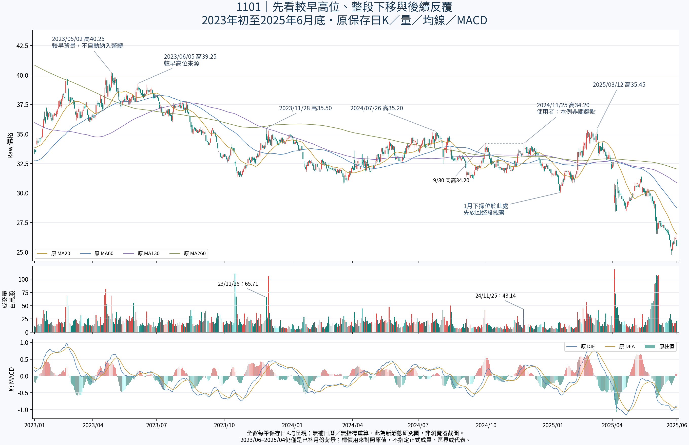

# 廣角下的反彈路徑：最大量、最高收盤、最高日高分開看

接續c12f1c0b638b5fcd325a3abf5d78115df6e15783。使用者只說下一步；本輪是助手原值研究，不批准正式成員或關鍵點算法。前輪一月小窗三選一已撤回，不再追問；11/25本例非關鍵點的更正保持，不另選一個局部凸點替代。

圖完全沿用，不新繪、不裁成小窗。先看2023較高來源與後續反覆區的完整位置，再沿原資料讀2025年一月到三月這段反彈。以下43筆觀察窗從原1/13低點到原6%三月高點的3/24確認日，只為核對證據；不是人工局部箱起訖、正式整體範圍、完整經濟波段或新選窗公式。原597筆視野及前後路徑保持，不以43筆替代整體。

## 同一觀察窗內，三種事件落在不同日

|2025年日期|原日高|原收盤|當日成交股數|原值呈現的角色|
|---|---:|---:|---:|---|
|2/25|35.10|34.95|57,322,068|此43筆窗內最大量；日高仍低於較近參照35.20|
|2/26|35.35|35.25|35,394,831|此窗最高收盤，收在35.20上方|
|2/27|35.20|35.10|34,165,236|下一保存記錄收回35.20下；日高只是相等|
|3/05|35.25|35.15|27,308,657|日高再越35.20，但收盤未過|
|3/12|35.45|34.50|22,178,529|此窗最高日高；低於更左35.50達0.05，收盤較前收34.80低|
|3/13|34.40|33.40|41,559,442|次筆回落、量高於3/12；不能由此推定持有人或壓力因果|
|3/24|33.60|33.15|35,223,581|原6%轉折到此才確認，非3/12即已確認|

最大量在2/25、最高收盤在2/26、最高日高在3/12，不能把3/12單根當成這段全部價量表現。1/13～3/24全部43筆核對，收在35.20以上只有2/26；日高在35.20以上有2/26、3/5、3/12，日高相等是2/27。這是同窗原值清單，不是突破率、成功率、獨立次數投票或新門檻。

35.20取自2024-07-26原高，35.50取自2023-11-28原高，39.25取自2023-06-05原A。三者都是助手明示的原值對照，不指定正式人工整體代表／區界。43筆內無日高達35.50或39.25，原最高35.45不能補成35.50相等或已過。未到39.25也不等於已證明它是人工整體正式高點。前輪已有更長原記錄的背景核對，勿將這個43筆窗當全歷史。

## 能支持什麼，還缺什麼

**可支持的研究描述：** 這次反彈曾收上較近的35.20，隨即回到其下，後續幾次日高再走高，仍未到更左35.50，隨後回落。這是一段具有先後關係的原值過程，比孤立的一個轉折日更適合研究它在廣角結構中的作用。較近參照有被走過，不能取代更左參照仍未到的事實。局部與整體分判是已定概念，本輪只提供具體證據，不再索答。

**不能支持的升級：** 不因2/26收過35.20就宣告突破整體，不因3/12回落就指定它為正式代表、證明某批籌碼壓住、批准整段歸屬或解除。量最大日與轉折日不同，亦不建立「量在前幾天才算」時間容忍／多日量門檻。此例不判定3/12是不是新的使用者關鍵點，沒有以它取代被否定的11/25。

原MACD也提供需分開的事實：3/12及3/13 DIF、DEA仍正，柱值卻已負，且價格回落；不可籠統稱「正MACD＝轉強」。完整精度直接沿用原值，沒有重算指標或提出買賣規則。日OHLC不能證明單日內先過、後回測的路徑。

## 左側來源本身也不是一根K能交代

原2023-11-28日高35.50、收34.50、量65,709,089；隔兩筆11/30日高35.30、收34.95、量106,415,572。更高的單日量和更高收盤出現在低於原35.50的另一根K。這不刪11/28來源，也不將11/30改選代表；它說明左側形成背景不能只用高點當日那一筆量來概括。原11/28～11/30三筆全保留，不將三筆任意窗口正式化或比較不同長度區間的總量／排名。

**研究進展：** 現有「轉折點＋其當日量」不能單獨承擔正式整體歸屬判斷；需要連同接近、原值跨越、收盤保持或跌回、後續反應的完整連續證據來閱讀。本輪保留這個證據組織方向，沒有新生產計算規則，也不要求重做已完成的query／reaction工具。正式歸屬仍UNKNOWN，primary_pressure_id=null。

## 實際核對與限制

完成：核分支最新、讀三根交接與前輪更正／全景；沿原comparison讀完整43筆及對照來源原ID／確認、三個同窗最大值、對三參照逐筆Decimal高／收／相等關係；核3/12原6%確認3/24、左側相鄰三筆原價量，原comparison／query SHA不變；沿用PNG並從GitHub核對。audit.py只讀原JSON、不匯入任何M1引擎。GitHub逐檔回讀見GITHUB_READBACK.json。

沒有新繪圖／瀏覽器截圖／UI、原辨識／MACD／reaction重算、source query adapter CLI、bootstrap、14／22或任何舊產品測試、新ZIP或Android。前輪缺Chromium未解除；Android NOT_TESTED_NEW_BUILD，file://不重試不繞過。原14測試／27檔回讀和fixture失敗修正保持歷史資格，非本輪重跑。這是只讀資料核對，非新核心測試或回測成功。

本輪窗／參照／日期屬後來研究選取，historical_selection_time=null，historical_signal_eligible=false；不能把3/24確認回填3/12。價量支持與反證不等可交易訊號；正式成員區界代表、增量量權重、衰減重要性、合併直接承接、解除生命階段仍未知。未挑戰舊帶高點前不因低位整理先降本例重要性保持。

原共享交界角色仍PENDING_NOT_REASKED；月份39筆5/13、6/3、1/27及三已定概念不重問。五月反覆站回／跌回、紅K較前收跌，十月日高越收未過／低點相等／正MACD跌回保持。原拒絕餘量−2.4800／−0.7825、49轉換非訊號、89版本84幾何非獨立、不同窗不排名、A三箱與六月前40.25不自動納入人工整體、九點末反彈／119前33後77只作背景、同座標不合併投票、不跨尺度冒同尺度路徑保持。

Raw公司行動、五年Adjusted、歷史可得、九待核非窮盡日曆、Darvas、SQLite未知；核心NOT_ESTABLISHED／分類NOT_VALIDATED／行動NOT_EVALUATED。不調參、不硬編人工答案、不新增自動選關／合併／解除／量或買賣門檻，不改原核心參數策略庫歷史舊頁案例及main，不部署付費交易訊息子代理。下一步仍Work研究這類完整過程對整體角色的支持與反例；已定規則或可重現工程缺陷才交Codex。完整續接見WORK_HANDOFF.md。
