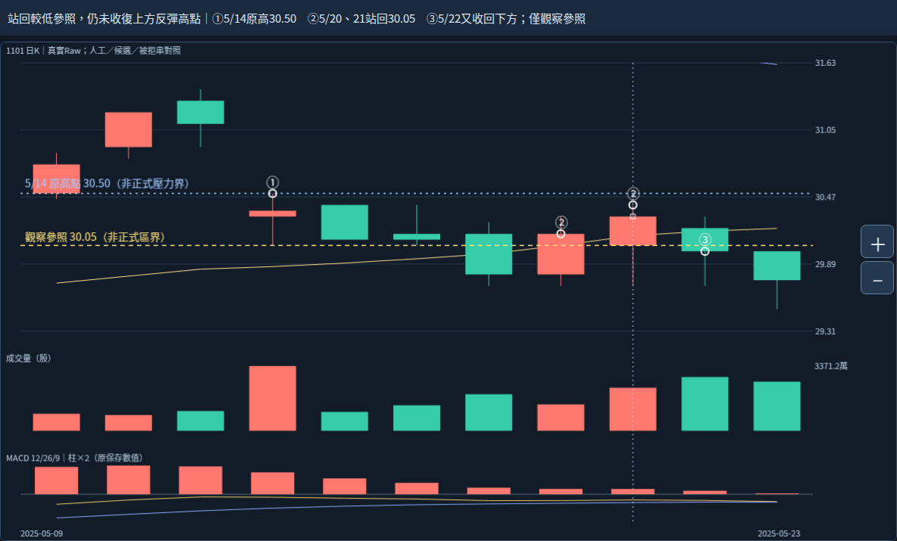
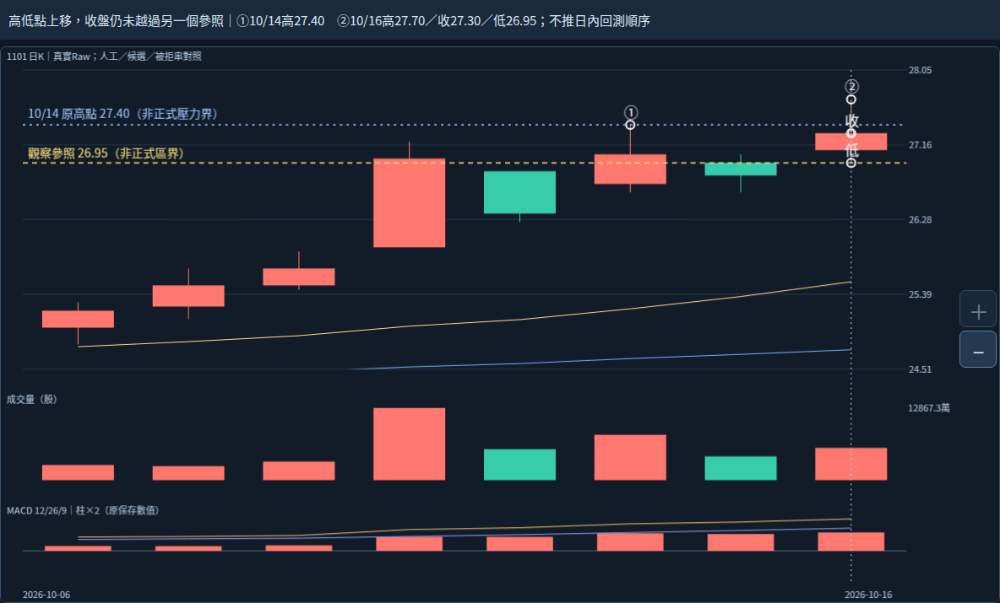

# 2026-10-20｜局部反應事實層：已可整理成有限工程任務

本輪從c0d063082bce74cd964ef4962d979c59204c4a84接續。使用者上輪已明確同意「局部重返／突破與整體壓力解除分別判斷」，不重問。本輪「繼續」是工作授權，不當作新策略核准。

## 新真實差異：站回一個參照，不等收復上方跌勢

5/19收29.80跌回30.05下方後，5/20收30.15、5/21收30.30又在其上，不能說5/19後一路留在下方。但是兩日最高僅30.30、30.40，仍低於5/14原高30.50，更低於5/13原高31.40；5/22收30.00再回30.05下方。

另一個容易誤讀的地方：**5/14在原圖是紅K，卻比前一日收盤更低。** 開30.30／收30.35，較開盤上漲；但前收31.10，日收盤差−0.75，當日高30.50甚至低於前日低30.90。原量33,711,861股，比前一筆10,264,322股約3.28倍。這只能說原股數增加，不能因紅K／量大／MACD柱為正就稱轉強；Raw跨日不重疊也不認證已驗公司行動後的正式缺口。

本輪研究判讀：這段的局部站回與較低位置反覆、上方尚未收復可以同時存在。這不是正式壓力牆認定或5/14自動選牆算法；30.50是明示查詢的原高價參照，未定量權重、失效或出場條件。

## 近期差異：盤中創高與收盤越過也不是同一事實

| 2026/10/16原值 | 客觀關係 |
|---|---|
| 高27.70／低26.95 | 比10/15高27.05／低26.60都高，單日價位範圍上移 |
| 收27.30 | 高於26.95原參照，但低於10/14高27.40 |
| 高27.70 | 曾高於27.40；不等收盤已越過27.40 |
| 低26.95 | 與原參照相等；不等日內「先突破、再回測」已被日線證明 |

我的判讀是局部改善有新證據，但仍有尚未收復的參照與後續未知。不能叫它已完成回測或成功突破全部壓力；10/16後無新資料。五月與十月只作概念反例，不作成功率／重要性或不等長報酬排名。

兩張圖用同一固定1101／Raw／2026-10-16成品；黃線為原研究界，藍線為明示原高價的觀察疊線，皆非新正式壓力區界。全原值、來源和比較見facts.json。

## 已可交工程的部分

已整理[REACTION_FACTS_CONTRACT.md](REACTION_FACTS_CONTRACT.md)：新增與UI、原核心分離的純數值事實附層。它對每個有來源與可知時間的明示參照，分別保存收盤／最高／最低在上、在下或相等；另列紅綠實體與較前收漲跌、相鄰原高低比較、原量比較、原MACD及完整越過／跌回路徑。

這些比較由既有原值直接推導，未新增選股／壓力權重。參照來源與自動選取是兩回事：30.50及27.40在本輪只是明示查詢，不得寫死進生產算法，也不能稱自動主壓力。原核心及manual audit不互相餵答案。

此工作可進入Codex做**有限的事實紀錄層**，不必再就上述算術逐項問使用者；目前沒有實作新模組、重建產品或執行契約驗收測試。不能將交接文件當工程完成，也不能把這一層當完整主壓力辨識。正式區界、主要壓力選擇、解除條件、合併／承接、量與動能權重仍須Work研究。完整工程範圍、必讀與限制見[CODEX_HANDOFF.md](CODEX_HANDOFF.md)。

## 實際執行與保留限制

本輪確認指定分支與c0d0630相同，讀三份根交接最新節並沿用本對話已全文讀過的同版來源；沒有重讀101圖片或0.4.3。沿用原HTML／完整JSON重新核SHA；Chromium133 loopback HTTP兩個新閱讀窗，明示觀察字型／參照線／日期標記，2張PNG，完整data／core／分析身分前後全等、原HTML SHA不變、0pageerror。另以Decimal只讀核對9筆原記錄與前筆／參照／MACD，不是辨識或指標重算、bootstrap、7 Python／47 Chromium或產品／觸控／下載回歸。觀察腳本與報告保存。沒有新ZIP下載／CRC或Android；file://未用、未重試或繞過。

來源末轉折、確認、研究離箱、人工終點分開；B77、月份主帶、左右拒串、人工39筆與B44/B80同幾何、B88與六月後整體歸屬差異保持。左高群6.05／容許3.5700／餘量−2.4800及右低群3.25／容許2.4675／餘量−0.7825不變，不調參湊答案。89版本／84幾何組非獨立型態，廣義後來非直接承接，不等長觀察窗不排名。

primary_pressure_id=null；正式區界／量口徑增量／衰減重要性／合併直接承接／生命階段未知。Raw公司行動、五年Adjusted、歷史可得、9待核日期與日曆非窮盡、資料缺口、Darvas正文、SQLite未知；核心NOT_ESTABLISHED／分類NOT_VALIDATED／行動NOT_EVALUATED、Android NOT_TESTED_NEW_BUILD保持。不改main或原核心參數策略庫歷史舊頁案例來源證據，不部署付費交易訊息子代理。新工程前須依AGENTS在實際完整checkout準備，不能沿用別環境bootstrap成功。
