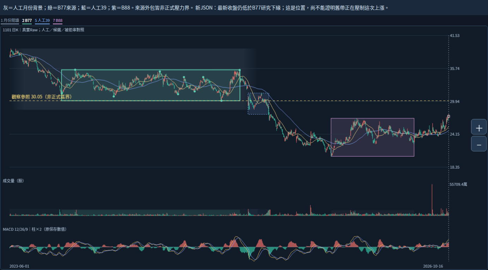
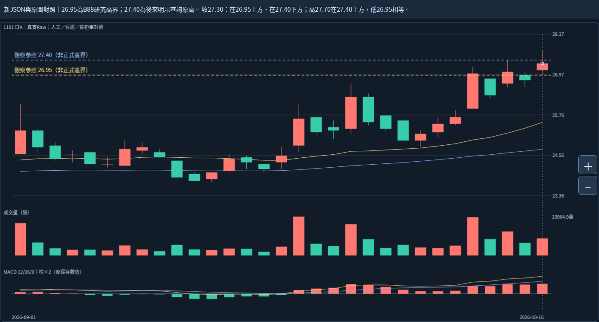

# 2026-10-20 Work｜新反應事實附層與整體壓力的證據範圍

研究狀態：ASSISTANT_ANALYSIS_NOT_USER_ADJUDICATED。固定1101／Raw／2026-10-16收27.30，非即時。使用者已確認局部與整體分別判斷，本輪不重問；沒有新增選關、解除、量權重、重要性或買賣規則。

## 本輪結論

新附層已能精確回答每個明示參照的價格位置與路徑；**局部支持與反證必須對應各自要回答的問題，不能把四個參照當四張多空票，也不能把「仍在上方」直接解讀為「正在壓制這波上漲」。**

原使用者指出的月份大帶及本例較高重要性保留。新四參照並未提供整個人工大帶的正式區界或整體強度更新算法，所以不能用它們選出正式主壓力或宣告全帶減弱／解除；也不能反向說舊帶永遠不會減弱。

## 先看長期背景與現在的位置

灰色只是2023-06～2025-04人工月份背景，綠色為B77來源，藍色為人工39筆，紫色為B88來源。外框都是來源影線外包，不是正式區界。黃線30.05只來自新JSON的B77研究下緣，不是人工整體大帶的正式底線。

最新日高27.70、收27.30均低於30.05；本輪9/1～10/16閱讀窗內31筆保存日K的日高也都在30.05下方。因此，這個閱讀窗沒有提供價格重新接觸該參照後受阻的實際反應。這不否定上方歷史背景的重要性，只分清位置證據與該處正在施壓的反應證據。31筆是選定閱讀窗的事實，不作強度分數或跨箱重要性比較。

## 四個參照，適用範圍不同

| 新JSON來源 | 已保存事實 | 可回答的問題 | 不能直接推論 |
|---|---|---|---|
| B88研究高界26.95 | 10/16收27.30在上，低26.95相等 | 最新完成收盤相對這個研究參照的位置 | 六月後整體已自動辨識、回測已完成、人工主帶已解除 |
| 10/14原高27.40 | 10/16高27.70在上、收27.30在下 | 日高曾越過，但收盤尚未越過這個明示原高 | 整體方向必然失敗，或27.40已被自動選為主要壓力 |
| B77研究低界30.05 | 最新高／收均在下，收差−2.75 | 尚未返回B77原研究走廊 | 人工整體大帶正式下緣等於30.05、B77正在壓制這次上漲 |
| 5/14原高30.50 | 最新收盤在下；五月20／21高亦未越過它 | 對這個明示原K高的收復程度 | 它必然是正式壓力牆，或可與其餘參照平權投票 |

26.95在此新JSON的來源是B88研究界，與人工1/27代表同價；來源角色及確認日期仍分開，不變成兩張成功票。30.50、27.40仍為後來明示原K查詢；沒有新增自動選關算法。

## 局部支持、反面證據與缺證同時保留

**局部改善的支持：**10/16收盤再位於26.95上方，相鄰K高低雙端上移，原DIF／DEA／柱為正且較前保存記錄增加；前筆量比約1.36，僅描述原量。這些支持局部改善的研究判讀，不是已核強勢型態或量增資格。

**局部仍有反面證據：**10/12～16上／下／上／下／上全路徑保持；10/13柱略增仍跌回，10/16收仍低於27.40。反證要針對「已持續守住」或「收盤已收復27.40」等具體主張，不把它擴大成整體必然轉弱。低點相等不補成過破，也不由日OHLC推日內回測順序。

**五月反例仍有效：**5/14紅K但較前收跌，原高低於前低，量較前筆約3.28倍仍不是買盤強弱定論；5/19收在30.05下而柱正，20／21再站回卻未收復30.50，22再跌回。它說明局部回返可以與上方未收復同時存在，不用後來五月的結果斷定十月必失敗，不作不等長表現排序。

**整體仍缺的證據：**正式人工大帶區界／代表與主次關係未定；沒有在本輪新輸出中量到整帶目前賣壓、剩餘持股或正式整體消化程度；量口徑、增量／衰減、重要性、合併／直接承接／生命階段未定。四參照的算術完整，不等整體語義完整。Raw跨公司行動可比性、歷史公布可得等來源資格仍限制長期判讀。

外部逐主張判讀見claim-scope-review.json；只是研究審閱，不輸入或改動原數值附層。

## 真正的新核心歧義

這次不是重問大帶月份、日期、39筆、局部代表或局部與整體要分開判斷。新問題是：

**在價格尚未回到左側舊大帶前，右側低位長期整理與反覆成交，是否足以先調降舊帶的重要性？還是要看到價格回到該處後的實際反應，才調整舊帶評估？**

我的暫定研究建議：低位整理可作為「後續挑戰能力可能改善」的候選證據；先與「舊帶本身賣壓已變弱」分開。日量及低位反覆不直接證明舊持股已換手完畢，時間經過本身也不加確定性。是否允許接觸前調整重要性及所需證據，尚未獲使用者裁決；不自行新增衰減或權重。這不改本例大帶已被使用者指出較重要的既有判讀。

## 本輪真正執行

分支起點db000b9a7a09c2bbc693e9d2094482a5edd6b867，確認與指定分支相同，且包含新成品2d9c9aad4b88b53d9552e479a3f625377f2b7161及原圖fff47915523fab8c8de8279de8bbb7a26b05647b。依序讀根AGENTS、CONTINUE頂端、核心續接最新節；全文讀新交付README／WORK_HANDOFF／GitHub回讀收據、reaction_facts README／驗收報告／selection，沿讀完整原契約、原facts與user-decision.json。原契約NOT_IMPLEMENTED是舊時點紀錄；最新附層已完成，不重做。

本環境新下載資料ZIP965,955 bytes，SHA256 a18150ff8d548cb0456a2df446711a472e31f93abf06bfd663238a28f0ba546e；6成員CRC及manifest列出的SHA重新核。取到11,672,241-byte新reaction-facts.json，SHA097971c913b52fbf69dbb286c6e2df380ded3c3d166ca6391de5c5bdb4047c48。原comparison-data與前輪固定檔逐字相同；新附層全部1213筆original_bar、原MACD與原資料逐值相同，source／basis／frame／prefix／原core ID相同。新result_id為sha256:2dcff9ba28edf89c370c976a82ec5b7bd6c11cce06743ba3e870e15a0d58c966。按需讀參照catalog、10筆完整案例記錄及近期窗口，未重算所有輸出或執行verify引擎；詳read-observation.json。

四參照selected_at均為2026-10-20T02:03:12.608303+00:00；known_on各自保留原確認或原完成日，historical_selection_time=null、historical_signal_eligible=false。五月不能拿尚未存在的十月參照作當時訊號，新JSON相關關係保持不可用。49分欄位轉換／分段索引不是49訊號，89版本／84幾何組非獨立型態。

以原未改HTML在Chromium133 loopback HTTP實開，兩個閱讀窗配合新JSON catalog畫觀察參照線，保存2PNG；觀察DOM／Canvas字型替換明示，原字型首圖留前輪。原data／core／分析日與新JSON位元組均不變、0pageerror。這是本輪有限讀圖，不是新附層UI、完整互動／觸控／下載回歸或Android，未重做原圖工程。沒有bootstrap、22項測試重跑、reaction/core/MACD引擎重算或重跑舊7／47等套件。

primary_pressure_id=null及全部正式未知保持。原左高群6.05／容許3.5700／餘量−2.4800，右低群3.25／容許2.4675／餘量−0.7825不變；來源末轉折／確認／研究離箱／人工終點不混同；廣義後來非直接承接，不等長觀察窗不排名。Raw公司行動／五年Adjusted／歷史可得／九待核日期與非窮盡日曆／Darvas正文／SQLite未知，核心NOT_ESTABLISHED／分類NOT_VALIDATED／行動NOT_EVALUATED、Android NOT_TESTED_NEW_BUILD保持；file://未用未重試未繞過。

下一步同Work，用全景釐清上述新核心歧義；已定規則或可重現工程缺陷才交Codex。本輪未發現必須先修的工程阻礙。保留全部核心參數策略、庫、歷史、舊頁、案例來源證據及main，不重讀101圖／0.4.3或舊手機驗收，不部署付費交易訊息子代理。完整續接見WORK_HANDOFF.md；研究與實際證據同分支保存並逐檔GitHub回讀。
