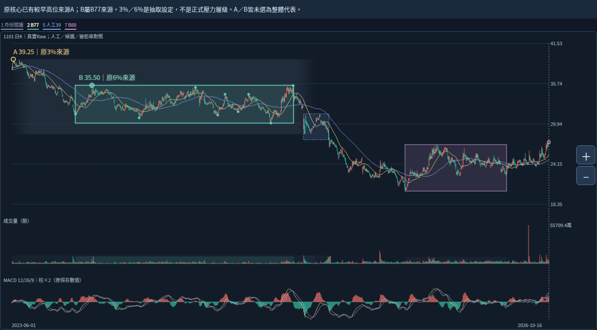

# 從「路徑相連」推進到可用的單一來源反查

接續a30b62f050c8ca55668f54f7a0bd3e46955d6bda。不同形態整體概念已確認，不重問；本輪「下一步」授權繼續研究，不是新增自動合併規則。

## 新核對的事實

原3%／segment=0的已確認轉折序列共119點，從2021-11-29到2026-10-13。前輪A到B來源的9點路徑，只是其中明示閱讀子串；前面還有33點，後面還有77點。原segment在此是原數值分段身分，不能當作「同一個經濟壓力結構」的認證。後續還會接到2024-01-19低31.80等原轉折，沒有原規則替大帶在那9點結束。

所以「有一條連續原路徑」仍不是充分歸屬條件。它可讓我們追蹤實際如何下移、反彈與進入反覆區，但不能單獨決定整體起訖，也不能沿歷史一直併。原來源與確認全部保持，沒有新造停止條件。

本輪也核了前輪兩組3%／6%座標對照的完整source_dates相同；原ID及確認仍各自不同。同座標不合併、不獨立投票，原歷史可知與本輪選取時間分開。

## 直接可推進的工程

已全文讀既有graph_diagnostics/README.md、build.py、diagnose.py及viewer.js。原診斷已保存完整來源序列、原箱source_turn_ids、來源版本與同幾何關係；目前所讀介面以候選箱／同端點診斷串查詢為主。不能把已有數值稱為缺失或另造第二套診斷。完整checkout仍須搜尋是否另有等價來源反查，找到就重用。

**可先把「從單一高低點查回所有原箱／同座標來源／明示中間路徑」做成既有診斷內的純數值查詢。** 這是既有來源的引用與精確切片，不需要先決定自動大帶合併、時間距離或重要性門檻。它把前輪人工翻大型JSON的審閱，變成可重現的小查詢；讓後續整體關係研究保留單點角色而不被整箱綁住。

詳細輸入、驗證、時間語義、拒絕條件、真實oracle與測試範圍已寫成SOURCE_QUERY_CONTRACT.md。此範圍READY_FOR_BOUNDED_ENGINEERING；生產查詢NOT_IMPLEMENTED、契約測試NOT_RUN。本輪沒有重做reaction_facts、原核心或圖表，也沒有把文件當成查詢功能完成。自動整體歸屬仍須Work；可交Codex的是精確反查工具，不是自動合併。

## 本輪實際執行

確認分支與a30b62f相同，依序讀三根交接最新節及前輪完整續接。只讀固定fff4791原comparison-data與前輪審閱結果；新probe.py實跑一次，核全119原轉折與原K欄位、9點原有序子串、兩組完整source_dates及原ID／確認，來源bytes全等。完整結果在path-audit.json；它是研究審閱，不是生產query輸出或核心重算。

讀檔曾誤查不存在的graph_diagnostics/core.py，取得無content後儲存暫存失敗；API目錄列舉URL亦被工具判為invalid path。改讀已知build.py的實際import，定位並完整讀diagnose.py成功。未修改或覆蓋任何產品檔，也未將錯誤當核驗成功。來源讀取收據及SHA見provenance.json。

沒有bootstrap、原引擎／MACD／附層重算、新ZIP、22測試或新瀏覽器／Android。舊紀錄不當本輪重跑。原圖沿用不是新截圖；Android NOT_TESTED_NEW_BUILD，file://不重試不繞過。查詢契約待Codex依實際完整checkout準備、實作、測試及逐檔GitHub回讀。

固定1101 Raw、分析2026-10-16；非即時資料。保留舊大帶重要性，不擅定39.25／35.50／35.45或40.25為正式整體代表；月份閱讀背景不補精確端點。五月反覆站回跌回／紅K但較前收跌，十月日高越而收未越／相等低／正MACD跌回反例不變。原值可知、來源確認與實際選取分開；日OHLC不證日內回測先後。

primary_pressure_id=null；正式區界代表／增量／衰減重要性／合併直接承接／生命階段未知。原拒絕餘量−2.4800／−0.7825、49轉換非訊號、89版本84幾何非獨立型態、不同窗不排名與Raw公司行動／Adjusted／歷史可得／九待核非窮盡日曆／Darvas／SQLite未知保持。核心NOT_ESTABLISHED／分類NOT_VALIDATED／行動NOT_EVALUATED。

下一步可轉Codex完成本契約限定反查，之後回Work研究整體歸屬。完整可貼指令見CODEX_HANDOFF.md。保留原核心參數策略庫歷史舊頁案例及main，不部署付費交易訊息子代理；同分支逐檔回讀收據見GITHUB_READBACK.json。
