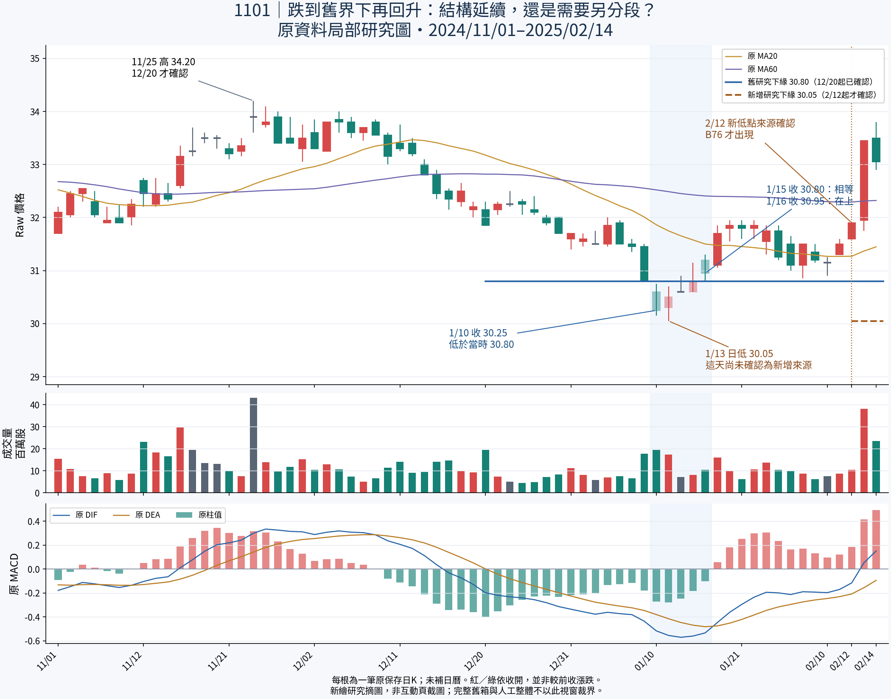

> 最新更正（2026-10-20 16:42）：使用者拒絕此小窗作分析依據，指出11/25價量未過、非關鍵點。前述一月三選一已撤回 WITHDRAWN_RESEARCH_WINDOW_INSUFFICIENT，不是選第三項，不再待答。本頁下方保留歷史；最新以[廣角研究與使用者更正](../20261020_broad_context_correction/README.md)及[完整續接](../20261020_broad_context_correction/WORK_HANDOFF.md)為準。

---

# 一月下探與回返：來源版本延長，是否仍是同一局部結構？

接續已核37194f7f9ff5e96cdfbc1914841607496627246e；本輪使用者只說「下一步」，不視為任何待決規則的批准。仍在Work研究正式整體歸屬，沿用已完成反查與原圖；不改產品頁或數值核心。



這是從原互動圖的同一comparison-data.json逐筆摘出的**新靜態研究圖**，不是新瀏覽器截圖或產品驗收。原互動圖保持。全窗2024-11-01～2025-02-14含68筆保存日K，不抽樣、不補日曆；量、MACD、MA20／60都直接讀原字串，不重算。紅綠按收開，不等於較前收漲跌。此視窗不是原箱或人工整體的正式起訖；完整原圖脈絡見[前輪真實圖](../20261020_pressure_relations/overlap-context.png)及[來源／中間路徑對照](../20261020_intervening_path_work_review/README.md)。

## 具體事實

|日期／項目|原保存值|可知與限制|
|---|---|---|
|B74研究下緣|30.80|原確認2024-12-20；不是人工正式區界|
|2025-01-10|收30.25|低於當時舊研究下緣|
|2025-01-13|日低30.05、收30.50|低點當日有原行情值；尚未確認為新增6%來源|
|2025-01-15|收30.80|等於舊下緣，不補成站上|
|2025-01-16|開31.20、收30.95|收在舊下緣上；綠K但較前收上升，兩種比較分開|
|2025-02-12|收31.90；B76確認|1/13的30.05到此才確認並進入B76研究下緣|
|2025-02-13／14|收33.45／33.05|保留回升與次日收退，不畫成單向上升|

B74八個原來源ID是B76九個原來源ID的完整前綴，同6%／segment 0；這是機械來源版本延長。B76新增來源正是1/13低30.05，2/12才確認。圖上的新30.05界線只從2/12開始，不倒畫回1/13或更早；1/13標記只指出後來確認的原值。原OHLC、原轉折確認與本輪實際研究選取是不同時間，歷史選取仍null／historical_signal_eligible=false。

MACD原DIF／DEA在1/10～1/16仍為負；1/17原柱值轉正，DIF／DEA仍負。負值、柱值改變、單日量與回收舊界，均不自動決定同帶、另段、沉澱或買賣。日OHLC無法證明日內回測先後；不把此圖命名成已驗證假跌破。

## 新核心待判：只問這個真實局部案例

**這段下探後回升，較像原局部結構的延續／向下擴張，還是原局部結構已結束、後面應另算新結構？也可以判目前證據不足。**

此問不是既答「局部與整體分別判斷」，也不是重問本例舊整體重要性或正式解除。無論此例選哪一種，未挑戰舊大帶高點前，不因低位整理先調降其重要性的已定更正保持。

目前研究能確定：舊30.80的跌破事實不能被後來30.05洗掉；反過來，也不能因一次收破就自動斷成新結構。來源前綴支持版本連續，卻不足以證明經濟結構連續。圖上回升後又回落保留，不能用只選轉折的簡線隱去。若使用者答覆，只保存本例人工判讀；跨案例可泛化條件仍需正反例，不能把日期、價位或答案寫進核心。

舊共享交界來源正式角色問題仍PENDING，這輪不依賴也不重問。沒有將「下一步」當批准；正式成員／區界／代表／合併直接承接仍未知，primary_pressure_id=null。也未把B74或B76升為人工整體。

## 實際完成與未完成

完成：核最新分支與祖先、讀三根最新交接與上一輪研究；從原SHA資料摘出68筆連續原索引、核B74→B76完整來源前綴及新增原點／確認、用Decimal核1/10低／1/15等／1/16高；保存精確JSON、可重現研究繪圖程式與PNG；實際用view_image核看中文字、三面板對齊及界線時點。核原comparison與source-query SHA未變。本輪GitHub逐檔回讀另見GITHUB_READBACK.json。

未完成：本例人工裁決、正式整體歸屬及自動規則；沒有執行原辨識／MACD／reaction／query adapter CLI、bootstrap、14／22或任何舊產品測試、ZIP或瀏覽器／Android驗收。Matplotlib研究摘圖不解除前輪缺Chromium的限制；Android NOT_TESTED_NEW_BUILD，file://不重試不繞過。原14測試／27檔回讀及fixture失敗修正仍是先前工程證據。

保留五月反覆站回／跌回、紅K較前收跌；十月日高過收未過、低點相等、正MACD跌回等全部反例。原拒絕餘量−2.4800／−0.7825、來源時點、89版本／84幾何非獨立、49轉換非訊號、不同窗不排名保持；A/B16/17/18六月前40.25來源不刪，也不整箱納入人工整體。九點末反彈保留，119／前33後77只作背景，不串全歷史或猜終點，同座標不合併投票，不跨尺度冒充同尺度路徑。

正式增量、量權重、衰減重要性、解除生命階段未知；Raw公司行動、五年Adjusted、歷史公開可得、九待核非窮盡日曆、Darvas、SQLite未知，核心NOT_ESTABLISHED／分類NOT_VALIDATED／行動NOT_EVALUATED。不改原核心參數策略／庫／歷史／舊頁／案例或main，不調參硬編答案，不新增自動選關、不部署付費交易發訊息或子代理。完整續接見[WORK_HANDOFF.md](WORK_HANDOFF.md)。

## 重現研究圖

從完整原成品取得comparison-data.json（SHA見evidence.json），指定一個含繁中字形的字型：

```sh
python docs/visual-discussion/20261020_version_continuity_work_review/render_study.py --source <原comparison-data.json> --font <繁中字型.otf> --out <研究輸出目錄>
```

需matplotlib；本輪版本3.10.8。程式只讀原檔、核SHA後摘錄及繪圖，沒有呼叫M1引擎或重算任何指標。原值字串與完整來源ID見evidence.json；font來源及SHA見verification.json，字型不重複入庫。重新執行會將visual inspection狀態設回PENDING，須實際看新圖後才能另記完成。
