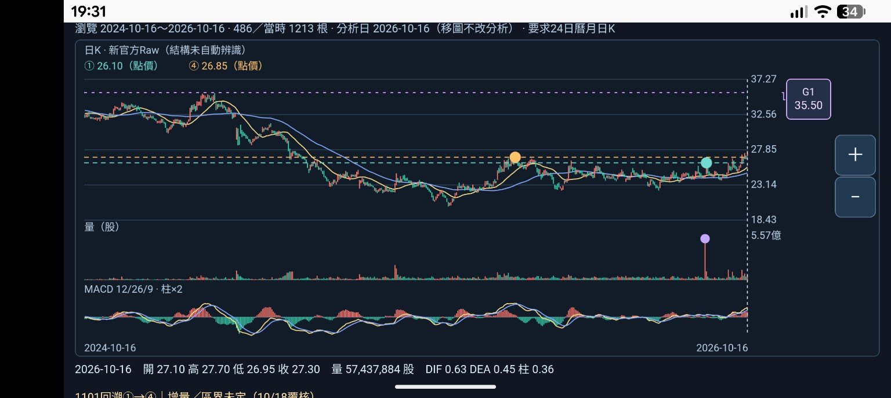
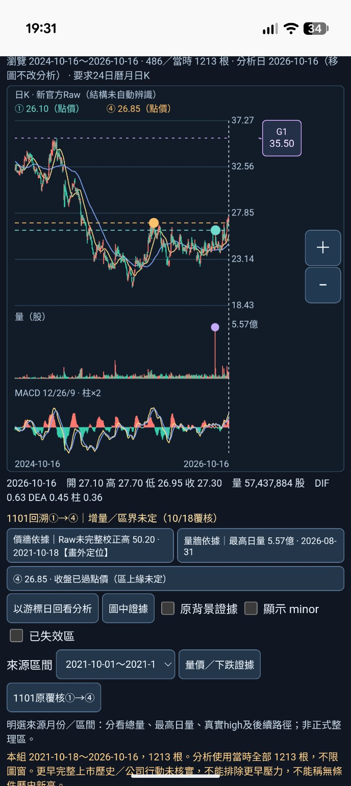

# 19:31線標籤直／橫畫面：差異已觀察，版本及互動待補（2026-10-18 Work）

## 範圍與身份
接續指定dev/m1-v018-chart-annotations。寫入前實際GitHub compare確認HEAD等於21d895d5029d4d05163ddde635cc152963b54ce2，包含81e8826d96b6a5c4a9a9aea0ce8601bb4fbf4712。保留後續成果，不從main／舊ZIP覆蓋。

使用者本輪僅提供兩張19:31截圖，沒有新的文字操作回報或JSON。上下文是0.2差異驗收，G1右欄標籤外觀符合0.2修正；但兩圖頁頂版本標頭均在畫面外，因此**不能僅憑外觀認證view_version或固定HTML SHA**。既有Pixel9Pro／Google瀏覽器資料是先前使用者回報，這兩張圖沒有獨立確認實際機型、OS或瀏覽器，不從狀態列外觀猜裝置。

附訊息帶有先前「No such file or directory」讀圖錯誤文字；本輪實際rg找到兩路徑，Pillow及view_image均讀取成功。錯誤文字不是股票頁開檔失敗證據。

## 直接觀察 OBSERVED
- 上方三關卡片未在兩圖可見區；主圖右側G1／35.50仍可辨，直向及橫向皆無肉眼可見的K線／價軸刻度／＋／−遮擋。這是當下畫面的檢查，不是像素碰撞測試或使用者閱讀感受回報。
- 兩圖直接顯示新官方Raw、分析日2026-10-16、24月視窗2024-10-16～2026-10-16、486／當時1213根。1101在直向底部案例文字可見。
- 價軸約18.43～37.27，沒有為50.20強拉範圍；G1價位在軸內、2023-11-28來源日期在當前窗外。35.50線上沒有可見的假當日G1來源圓點。成交量上的紫色點另屬既有量證據，不當G1來源點。
- K／量／MACD及末日讀值可見：開27.10、高27.70、低26.95、收27.30、量57,437,884股，DIF0.63／DEA0.45／柱0.36。僅確認畫面顯示與既有紀錄相符，沒有新原JSON逐欄位比對或獨立重算。
- G2／G3上方卡片及超軸文字未入鏡。當前圖未見它們被畫成軸內假線，但提示是否仍呈現不能由本圖確認。
- 兩張圖不證明直→橫→直的完整操作序列、旋轉前後保留值、點標籤不移游標、定位／返回或載入速度。

## 原檔保存 FILE_VERIFIED 的限度
已實讀並計算收到的兩份本地附件位元組指紋。保留原始收到的位元組，不重編碼：
| 檔名 | 尺寸 | bytes | SHA256 |
|---|---|---|---|
| Screenshot_20261018-193150.png | 1536×688 橫向 | 155615 | 6aff7582536437489d5c72eb0f1ca208da97032350ad59aa0d44d58bb0a7ef99 |
| Screenshot_20261018-193128.png | 688×1536 直向 | 189050 | 972fb99661e61e275fb128743c832726f1d536204f7ac73342fd6d961f03a737 |

收到的檔名副檔名為.png，但Pillow識別實際內容為JPEG；保留原檔名與收到的內容，不宣稱是手機未經平台處理的原始PNG。這是截圖檔案核對，不是0.2手機JSON驗證。

## 證據分類與下一步
| 類別 | 狀態 |
|---|---|
| 新版上下文下G1閱讀差異 | OBSERVED，直／橫兩畫面 |
| 0.2精確版本身分 | 待頁頂版本文字確認；未收到新HTML／JSON |
| 使用者實際操作回報 | 本輪尚無，不代填成功 |
| 新0.2手機JSON | NOT_VERIFIED，沒有收件 |
| 新故障 | 沒有足以認定的產品FAIL |
| 實機整體 | PARTIAL_EVIDENCE_OBSERVED_VERSION_UNCONFIRMED，僅收件畫面；不稱完整Android或核心用途通過 |

原0.2 NOT_TESTED_NEW_BUILD是收件前紀錄；現已收到符合修正外觀的部分畫面，版本綁定仍待確認。0.1 PARTIAL_EVIDENCE_OBSERVED與舊原圖／JSON全保留，不重要求相同舊檔，也不拿它填0.2缺證據項目。

下一步仍同一Work對話：
1. 使用者看頁頂，回報是否為「M1 三關主圖0.2」即可，不重收本次直橫主圖。
2. 點**主圖右側G1／35.50標籤**（非上方卡片），傳證據面板畫面；應顯示2023-11-28／35.50與後來人工覆核資格，分析日仍2026-10-16。
3. 關閉證據後回報圖窗是否仍24月486根、游標日期有沒有改。這與直接畫面觀察分開記。來源定位及24月返回可後續另驗，不預填。
4. G2／G3超軸提示、其餘未測手勢／同步移動／60根／各日定位／排除其他來源／效能沿最新紀錄待補。另驗下載才收0.2新原JSON。

## 工程及策略界線
本輪沒有產品修改、Python／Chromium執行、新行情抓取或數值重算；10 Python專項、208 HTTP與44標籤是前輪Codex報告，不是本輪實跑。原file://政策拒絕未重試／未繞過。
核心用途未認可；區界／整區量／增量／強度／衰減／自動選關／生命階段仍未定。公司行動／五年Adjusted／歷史公布可得、資料缺口及SQLite未知根因保留。Raw舊高不認證共同校正壓力，五年高不是完整歷史高。只新增證據與文件；原引擎、策略、庫、歷史、舊頁及main不改，無部署／付費／交易／發訊息／子代理。
