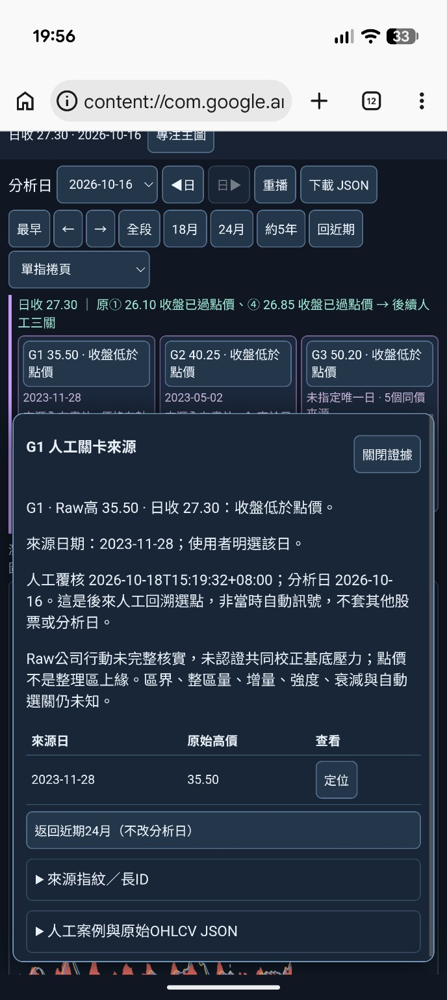

# 19:56 G1證據已見；0.2版本與關閉保持由使用者確認（2026-10-18 Work）

本輪寫入前GitHub compare：dev/m1-v018-chart-annotations HEAD與a8fa97dff2f4ce1c6cec85c474da766c875f04e4相同；包含指定81e8826交接，保留此前所有原圖、JSON及報告。

## 使用者回報 USER_REPORTED
使用者原話：**「1、2、3都可以」**。直接承接上輪三步：
1. 查看頁頂並確認「M1 三關主圖0.2」。
2. 點主圖右側G1／35.50標籤開啟證據（非要求再點上方卡片）。
3. 關閉後圖窗仍486根、游標未改、分析日仍10/16。

依語境記為這三步的整組成功回報，不是助手直接觀察連續操作或逐秒量測。0.2版本身份由使用者確認，不再反覆要求相同頁頂／主圖；沒有新HTML或新JSON可核精確artifact SHA。

## 直接畫面 OBSERVED
本輪截圖直接顯示「G1人工關卡來源」面板：
- G1 Raw高35.50、日收27.30、收盤低於點價。
- 來源日期2023-11-28，明示使用者選該日；來源表同日／35.50。
- 人工覆核2026-10-18T15:19:32+08:00；分析日2026-10-16；明示後來人工回溯選點，非當時自動訊號、不套其他股票／分析日。
- Raw公司行動未完整核實、未認證共同校正基底壓力；點價不是整理區上緣。區界／整區量／增量／強度／衰減／自動選關仍未知。
- 「定位」「返回近期24月（不改分析日）」及「關閉證據」按鈕可見。按鈕可見不當定位／返回已執行。
- 分析日選擇器直接為2026-10-16。瀏覽器地址列顯示content://com.google...，可支持content文件呈現當下頁面；不外推OS／精確機型／效能。
- G2／G3卡片標題與點價可見，但超軸提示下方被面板遮住，仍未直接驗到提示全文。G3卡片保留未指定唯一日／5個同價來源，不重新要求已核對0.1五日表。

圖窗／游標被證據覆蓋，**關閉後保持僅有使用者回報，沒有本輪前後截圖直接核對**。不把本圖當定位後圖或完整旋轉序列。

## 收到檔案 FILE_VERIFIED 範圍
本輪實際找到並以Pillow／view_image讀取附件，不使用Library重讀；訊息內先前No such file文字不當股票頁開檔失敗。
- 收到檔名：Screenshot_20261018-195649.png。
- 實際內容JPEG，688×1536，177544 bytes；保留收到位元組及原檔名，不重編碼。
- SHA256：811a695828a44efc46a8feefbae2ac1b558bd981684dfbca42641e019b2d8c84。
- 無0.2手機新原JSON；本次不是JSON數值／精度驗收。

## 最新狀態
**hurdle-chart-view/0.2：PARTIAL_EVIDENCE_OBSERVED**。
19:31兩張直／橫圖支持G1標籤不遮擋、卡片畫外仍可讀、24月486根、價軸未拉至50.20及沒有可見的假當日G1來源點；本輪新增G1來源及回溯資格OBSERVED、頁頂0.2與點選／關閉保持USER_REPORTED。19:31的VERSION_UNCONFIRMED為收件前歷史，身份已由使用者回報補足，不改寫舊紀錄。0.1 PARTIAL_EVIDENCE_OBSERVED與原圖／原JSON仍完整保留；不是借用舊版通過。

目前未發現可重現產品故障；不建立假FAIL，也不宣稱完整Android／核心用途通過。

## 下一步仍Work，僅補本輪剩餘差異
用已開啟的G1證據按「定位」，檢查游標到2023-11-28／35.50且分析日仍10/16；再按「24月」回486根。關閉面板後查看G2／G3卡片的超軸提示。請使用者一次回報這組操作結果；提示若需直接觀察只收當前新圖，不重收相同舊主圖／JSON。
若成功則記為USER_REPORTED；沒有圖片不代填OBSERVED。不以補齊所有舊手勢項目阻擋後續核心用途討論。其他未測手勢／同步移動／60根／各日定位／其他來源排除／持續效能保留，另驗下載才收0.2新原JSON。

本輪僅保存原圖與文件，無產品改動、行情抓取、數值重算、Python或Chromium新測試。10／208／44是前輪Codex實跑，不冒充本輪；原file://管理拒絕未重試／未繞過。核心用途未認可；未定策略規則、公司行動、五年Adjusted、歷史公布可得、資料缺口及SQLite未知根因保留。Raw舊高不認證共同校正壓力，五年高不是完整歷史高。原引擎／策略／庫／歷史／舊頁／main不改，無部署、付費、交易、發訊息或子代理。
