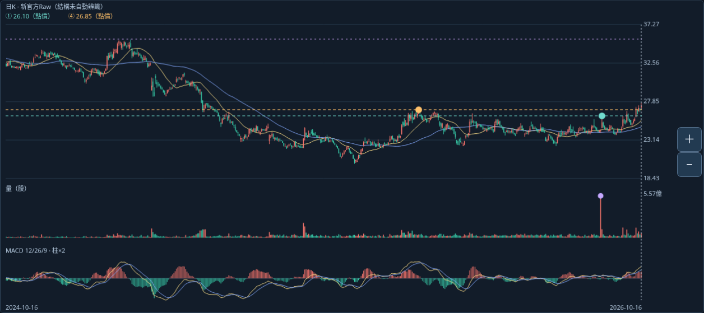
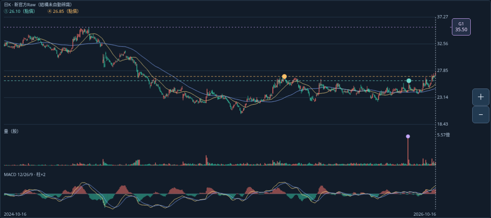
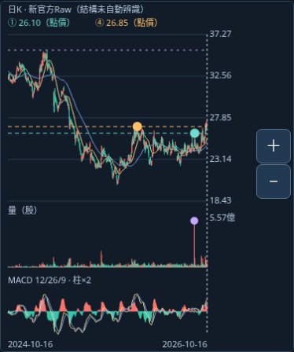
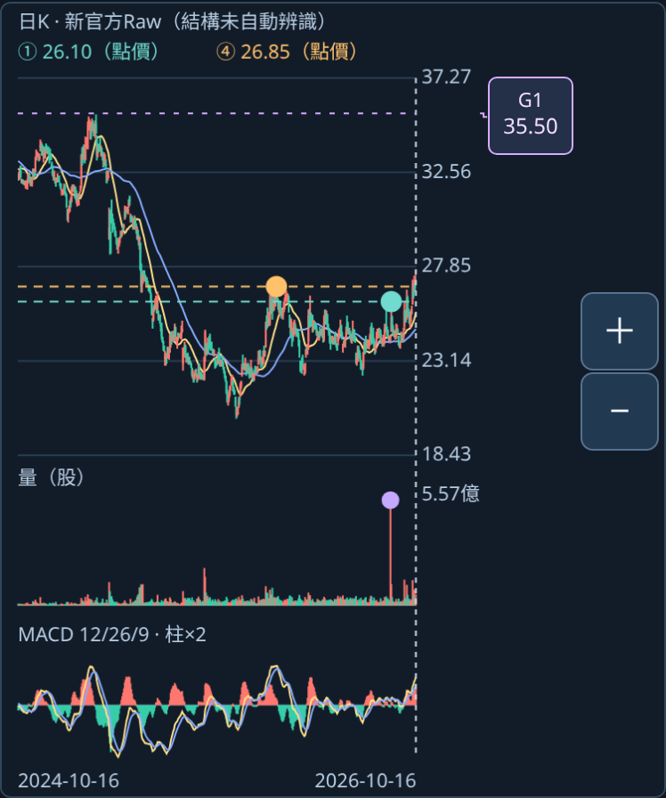
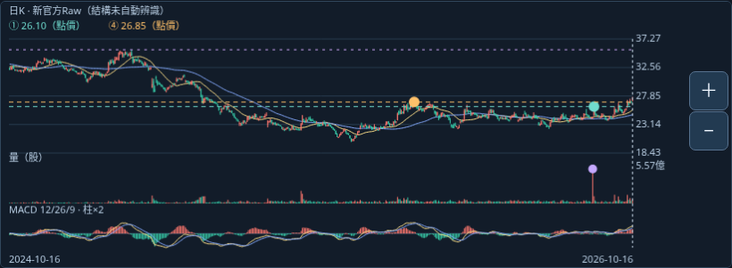
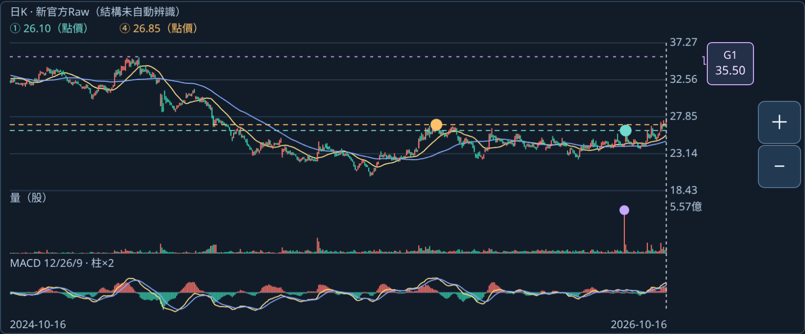
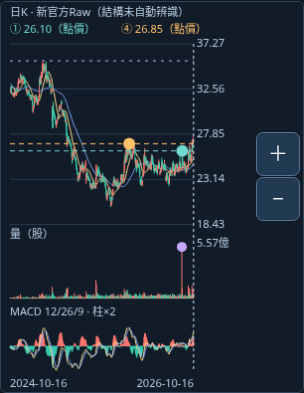
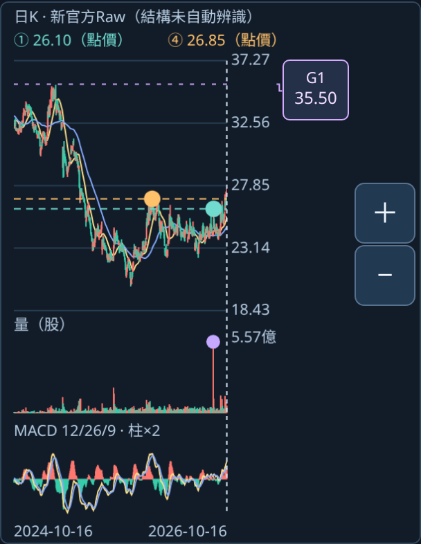

# 畫外G1線標籤：實際Chromium修正前後

這些是實際頁面截圖，非示意／合成圖；不是Android實機。四種視窗均1101／新官方Raw／2026-10-16、近期24月486根；上方卡片捲出視野，來源2023-11-28在畫外、35.50在價格軸內。

修正前是不可變0.1 HTML，SHA `4cbe923936f9841652e7a303ec60029f9159dffe3b266e468d04b573f060706c`；修正後是0.2 HTML，SHA `fe0d27111f9a03b23ea587cb195a5b5b3987b4862e7af6ee20684be1b69fbce6`。價格範圍同為18.426～37.274，不因50.20擴軸。0.2有人工層時右側多保留30px標籤空間；橫向主圖最小高度340px，保留三個44px標籤位置，K量MACD同軸不變。

| 視窗 | 修正前：紫線無G1文字 | 修正後：主圖內可讀G1／35.50 |
|---|---|---|
| 1280×900桌面 |  |  |
| 390×844直向模擬 |  |  |
| 844×390橫向模擬 |  |  |
| 320×740窄屏模擬 |  |  |

另見[窄屏G3真實來源窗](labels/G3-source-320.png)：來源圓點仍在五個真實日期，G1／G2低於價軸時不假貼邊；G3標籤可讀且不遮刻度或縮放鈕。[G1來源進入圖內](labels/G1-source-390.png)仍只有真實日期點，線標籤不改來源日。

已目視桌面、直向、橫向與窄屏／G3圖；實際互動與碰撞檢查見labels/label-report.json。使用者原17:41手機圖與已核對JSON仍在validation_android_20261018，不以本輪模擬替代或重要求相同原檔。
