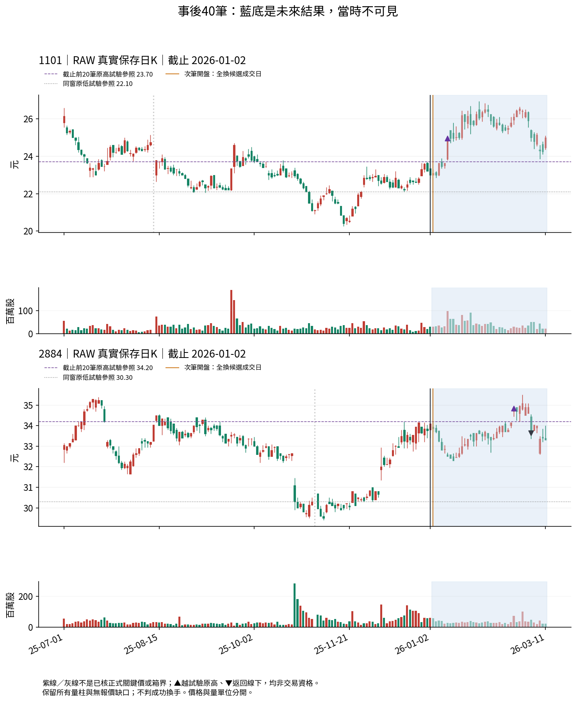
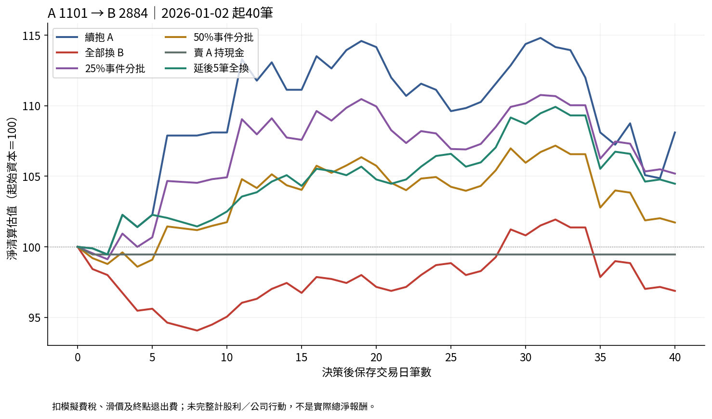
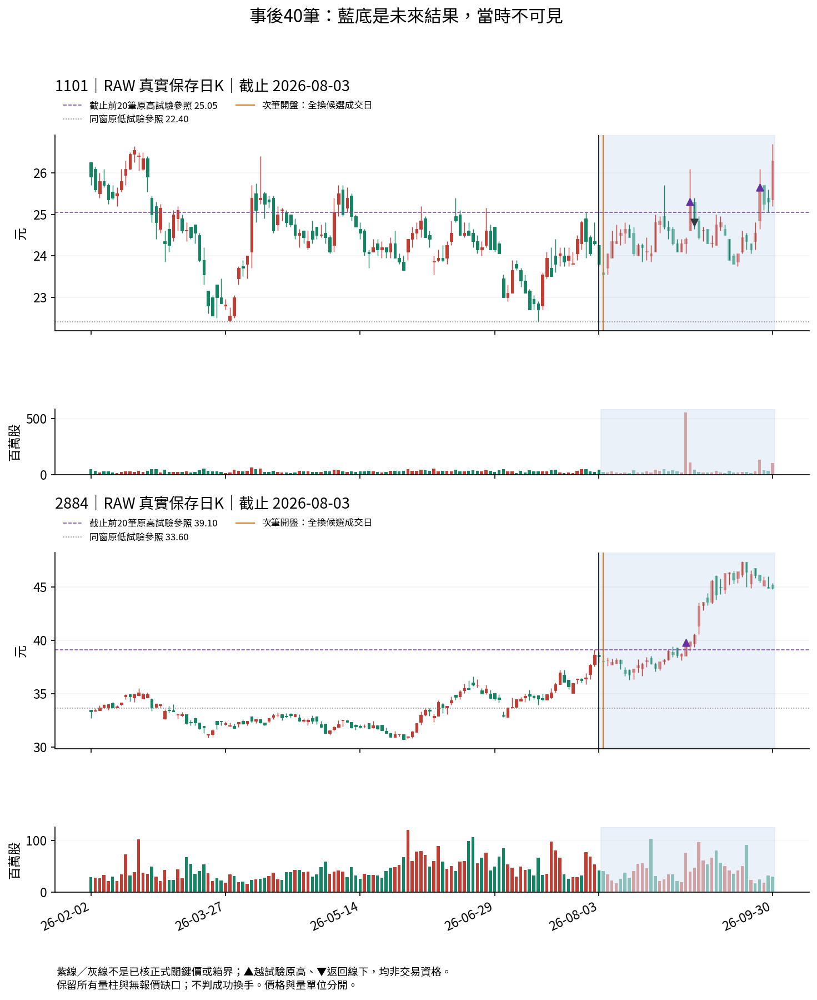
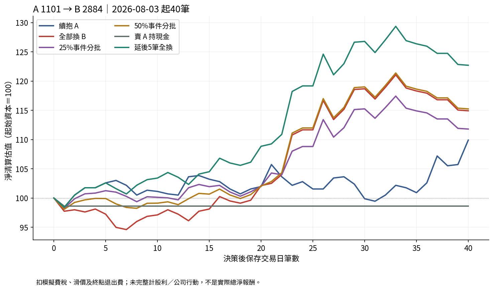
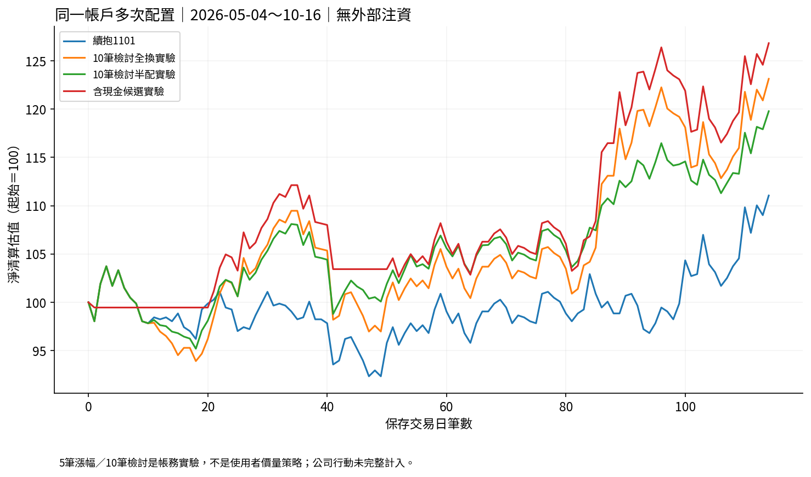

# P1-7 動態換股研究報告（2026-10-22）

**可執行研究版與帳務驗證已完成；全換／分批投資優劣仍未通過驗證。** 完整公司行動與歷史公布資格不足，本文所有百分比都是扣模擬成本的條件式價格報酬，非實際總淨報酬。未作正式交易規則或下單。

## 實際完成與範圍

獨立core、loop、外部不可覆寫store、CLI已實作。70組同時點同資本比較、每組6方案共420方案；另216成本／可用現金敏感度方案、4個單一連續帳戶。兩個9月1日的40筆不足拒算。18個定向unittest通過，來源／帳務核對9982項通過，CLI RUN與READ逐位元相等。圖表瀏覽器實測見browser-verification.json；不是實體Android。

現有分析引擎、資料來源、選擇保存可沿用；原庫不是持股／現金／成交帳，本輪新增的只是研究帳戶，不是正式資產管理產品。所有既有引擎／策略／資料／舊圖保持。

## 固定日曆案例：A1101轉B2884

起始A20,000股、現金0，決策收盤現值作共同本金。以下兩天均屬預先月初日曆，不按事後結果挑例。5／10／20／40筆皆有完整結果；此表顯示40筆。

### 2026-01-02 決策

|方案|淨價格報酬|收盤最大回撤|總摩擦元|淨利／交易日元|
|---|---:|---:|---:|---:|
|續抱A|8.106%|-8.663%|2711.00|932.23|
|全部換B|-3.122%|-5.933%|5913.25|-359.08|
|25%事件分批|5.193%|-5.029%|6461.05|597.22|
|50%事件分批|1.725%|-5.084%|6365.10|198.37|
|賣A持現金|-0.542%|-0.542%|2494.00|-62.35|
|延後5筆全換|4.473%|-4.957%|6223.60|514.41|

### 2026-08-03 決策

|方案|淨價格報酬|收盤最大回撤|總摩擦元|淨利／交易日元|
|---|---:|---:|---:|---:|
|續抱A|9.905%|-5.929%|2852.00|1178.70|
|全部換B|14.919%|-5.390%|6585.80|1775.36|
|25%事件分批|11.796%|-4.795%|6401.65|1403.71|
|50%事件分批|15.239%|-5.061%|6662.20|1813.44|
|賣A持現金|-1.378%|-1.378%|2559.00|-163.97|
|延後5筆全換|22.699%|-5.145%|7004.25|2701.14|

## 這些實驗能支持的解讀

1月案例：全換到2884後表現落後續抱1101，分批減少了立即全額轉入相對落後候選的暴露；但分批仍落後續抱，不能把降低損失說成最佳決策。8月案例：25%分批未能及時取得同等B曝險，期末落後全換；50%分批則小幅領先全換。固定延後5筆在此例較好，只是事後路徑結果，不得將5筆升為最佳等待天數。反向換股完整保留在報告選單與結果檔，不隱藏失敗方向。

**可提出的研究假說**：證據尚未清楚或候選轉弱時，較小初始移轉可能減少錯換風險；候選很快持續推進時，等待會付出未參與的代價。這是由條件式樣本推導的待驗假說，不是未來情境分類器／勝率或正式比例。價格先上與量未超最高不能直接判假突破；本輪只標與凍結試驗原高的越過／返回事實，不稱正式結構成功或失敗。

時間切分段38組中25%分批期末高於全換21組，50%分批22組；兩者回撤較輕各25組。這些觀察窗重疊、兩個方向相關、只有兩個已被專案讀過的股票，不能當獨立勝率或獨立驗證。未據此選比例、調門檻或宣布分批勝出。

成本／現金敏感度以相同20筆比較，報告可展開查看；不把20筆與40筆混比。交易成本、滑價、整張、前日量容量及現金可用限制都可能改變次筆完成度；全換意圖在容量不足時也可能分日成交，不等於主動分批策略。

## 多次配置與資金回收

loop.py在同一股數／現金帳中連續執行，零外部注資，逐筆扣成本；有續抱、每10筆檢討全換／半配／現金候選4個研究帳戶。不是重設本金後拼接獨立案例報酬。其5筆漲幅選候選是帳務測試假說，並未實作您完整圖形策略；即使此段價格淨值增加，也不能叫飛輪已驗證。

## 已完成研究但未通過投資驗證

公司行動與股利應收／發放、配股／減資、當時資訊可得、完整日曆與真實成交未核。RAW價差跨除息不得誤當經濟轉弱；完整事件鏈不足時不生造調整因子或補股利。來源、缺值與官方日期差異見DATA_QUALIFICATION.md。strict模式拒絕，沒有以條件式結果繞過資格。

20筆原高低只是試驗代理，不能取代已答P0-1～P1-6的正式重要性／箱界；正式結構UNKNOWN、量經濟角色UNKNOWN、剩餘空間null、交易資格false。弱勢占用時間目前僅有「未超試驗參照」代理，不能宣稱已完成正式弱勢分類或完整風險調整績效。

## 尚未完成與下一步

先完成來源可追溯的公司行動事件帳與總報酬會計、真正獨立資料資格，再擴增上櫃／全市場與長期風險評估。保留正反案例、不重開已答圖形問答、不擅定全換／分批。實體Android仍未測；下載SVG可放大、HTML提供250%圖幅與手機表格滑動。

目前無需使用者替研究猜分批比例；正式配置規則、核心參照與風險上限仍待實證後人工裁決。建議下一階段用Codex接明確的事件帳與總報酬會計工程；核心價量策略若出現真正歧義，再回Work以K量圖裁決。
